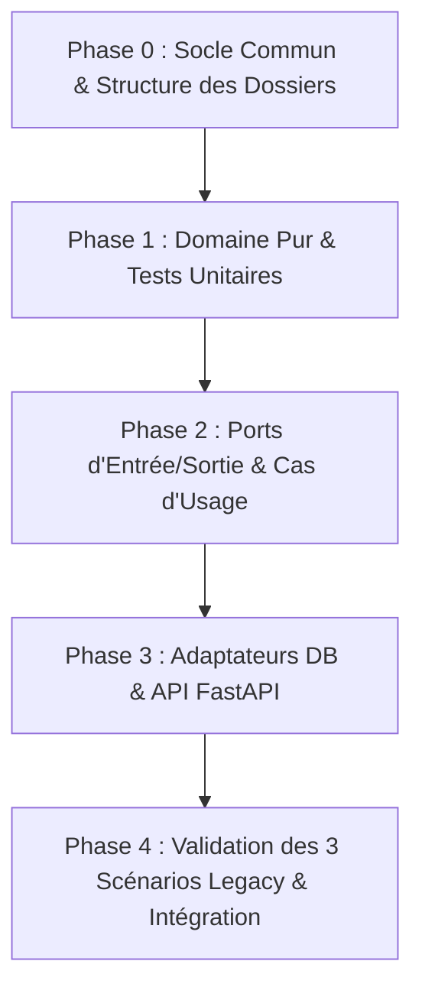

# Cahier des Charges & Feuille de Route — FestiPlan

## 1. Contexte & Objectifs

### 1.1 Présentation
**FestiPlan** est une application FastAPI destinée à la gestion d'un festival de metal fictif (*Hellforge Open Air*). Le dépôt initial contient une application de type "legacy" où la logique métier est dispersée, fortement couplée à la couche de persistance (SQLAlchemy) et au framework web (FastAPI), avec des effets de bord techniques non maîtrisés.

### 1.2 Objectif pédagogique
L'objectif est de refactoriser ce projet vers une **Architecture Hexagonale (Ports & Adapters)** stricte tout en corrigeant les bugs métier et d'atomicité identifiés, dans le cadre d'un travail collaboratif à 3 personnes.

### 1.3 Règles d'or de l'Architecture Hexagonale
1. **Indépendance du Domaine :** Le dossier `domain` ne doit importer AUCUNE dépendance technique externe (`fastapi`, `sqlalchemy`, `pydantic`, `httpx`, etc.). Il est composé de Python pur (`dataclasses`, types natifs).
2. **Inversion de dépendance (DIP) :** Le domaine et l'application définissent des interfaces abstraites (`Ports`). Les couches externes (`Adapters`) implémentent ces ports.
3. **Cas d'usage isolés (Use Cases) :** Chaque interaction métier est encapsulée dans un cas d'usage clair qui orchestre les entités du domaine et appelle les ports sortants.
4. **Testabilité :** La logique métier (`domain` et `application`) doit pouvoir être testée unitairement à 100% sans nécessiter de base de données ni de serveur HTTP en marche.

---

## 2. Défaillances métier actuelles à corriger

| Anomalie | Localisation Legacy | Comportement attendu |
| :--- | :--- | :--- |
| **1. Déplacement de concert non contrôlé** | `app/services/scheduling_service.py:reschedule_concert` | Vérifier la disponibilité de la scène, la disponibilité de l'artiste, l'adéquation du matériel requis/disponible, les dates du festival, et empêcher tout déplacement si le festival est publié sans dérogation. |
| **2. Effet de bord non atomique (Notification)** | `app/services/scheduling_service.py`, `app/services/publication_service.py` | La notification est envoyée après le commit DB. En cas d'échec du service de notification (`FESTIPLAN_FAIL_NOTIFICATIONS=true`), l'API renvoie 500 alors que les données sont déjà persistées. Isoler ou gérer l'échec de notification pour garantir la cohérence des données. |
| **3. Protection du statut "Publié"** | `app/services/publication_service.py`, `app/api/festivals.py` | La publication doit exiger qu'aucun concert ne soit en conflit et qu'un planning valide existe. Un concert ne doit plus pouvoir être altéré via l'endpoint ordinaire une fois publié. |
| **4. Données déstructurées (Équipements)** | `app/models.py`, `app/api/artists.py`, `app/api/stages.py` | Les équipements ne doivent plus être des chaînes CSV séparées par des virgules (`split(",")`), mais des ensembles typés (`set[str]` ou Value Objects). |
| **5. Fuite SQLAlchemy dans l'API** | `app/api/concerts.py`, `app/api/incidents.py` | L'API ne doit plus faire de requêtes directes (`db.query(...)`), mais déléguer aux Use Cases. |

---

## 3. Architecture Cible des Dossiers

```text
app/
├── domain/                                  # 100% Python pur, logique métier centrale
│   ├── models/                              # Entités métier (dataclass)
│   │   ├── festival.py
│   │   ├── artist.py
│   │   ├── stage.py
│   │   ├── concert.py
│   │   └── incident.py
│   ├── value_objects/                       # Objets-valeurs immuables
│   │   ├── time_slot.py                     # Créneau horaire (start, end, overlaps)
│   │   └── festival_status.py               # Statuts (PREPARATION, PUBLISHED...)
│   ├── exceptions/                          # Exceptions métier explicites
│   │   ├── scheduling_exceptions.py         # Conflits de scène, d'artiste, etc.
│   │   └── festival_exceptions.py           # Publication invalide, festival clos...
│   └── ports/                               # Interfaces abstraites (Protocol ou ABC)
│       ├── repositories/
│       │   ├── concert_repository_port.py
│       │   ├── festival_repository_port.py
│       │   ├── artist_repository_port.py
│       │   ├── stage_repository_port.py
│       │   └── incident_repository_port.py
│       └── services/
│           └── notification_sender_port.py
├── application/                             # Cas d'usage (Application / Use Cases)
│   ├── use_cases/
│   │   ├── scheduling/                      # Pôle Développeur 1
│   │   │   ├── schedule_concert.py
│   │   │   ├── reschedule_concert.py
│   │   │   ├── cancel_concert.py
│   │   │   └── get_schedule.py
│   │   ├── logistics/                       # Pôle Développeur 2
│   │   │   ├── create_festival.py
│   │   │   ├── create_artist.py
│   │   │   └── create_stage.py
│   │   └── operations/                      # Pôle Développeur 3
│   │       ├── publish_festival.py
│   │       ├── declare_incident.py
│   │       └── resolve_incident.py
├── adapters/                                # Adaptateurs d'infrastructure
│   ├── primary/                             # Entrants (Driving) : API HTTP
│   │   └── api/
│   │       ├── schemas/                     # DTOs Pydantic (Request/Response)
│   │       └── routes/                      # Routeurs FastAPI
│   └── secondary/                           # Sortants (Driven) : DB, Mail, Services tiers
│       ├── database/                        # ORM SQLAlchemy & Session
│       │   ├── models/                      # Modèles DB SQLAlchemy
│       │   └── connection.py
│       ├── repositories/                    # Implémentations concrètes des ports
│       │   ├── concert_sql_repository.py
│       │   ├── festival_sql_repository.py
│       │   ├── in_memory_concert_repository.py # Très utile pour les tests unitaires
│       │   └── ...
│       └── notifications/
│           ├── email_notification_adapter.py
│           └── fake_notification_adapter.py
tests/
├── unit/                                    # Tests unitaires purs (sans DB, très rapides)
│   ├── scheduling/
│   ├── logistics/
│   └── operations/
└── integration/                             # Tests avec DB / API FastAPI TestClient
    ├── test_scheduling_scenarios.py
    └── test_publication_scenarios.py
```

---

## 4. Répartition des Rôles & Tâches (Équipe de 3)

### 👤 Développeur 1 : Cœur Planification & Programmation (Scheduling / Concerts)
* **Domaine :**
  * Entité `Concert`.
  * Value Object `TimeSlot` (gestion début/fin, calcul de durée, détection de chevauchement `overlaps`).
  * Règles de validation des conflits (disponibilité de la scène, disponibilité de l'artiste, respect des dates de festival).
  * Exceptions : `StageOccupiedError`, `ArtistAlreadyBookedError`, `InvalidConcertDurationError`.
* **Application (Use Cases) :**
  * `ScheduleConcertUseCase`
  * `RescheduleConcertUseCase` *(Correction du bug 1 : réappliquer toutes les vérifications de conflits et de dates)*.
  * `CancelConcertUseCase`
  * `GetFestivalScheduleUseCase`
* **Ports & Adaptateurs :**
  * Port `IConcertRepository`.
  * Adaptateur `ConcertSqlRepository` (SQLAlchemy) et `InMemoryConcertRepository` (pour les tests).
  * Adaptation du contrôleur FastAPI `/concerts`.
* **Tests :**
  * Tests unitaires complets sur la logique de détection de chevauchement et de conflits.
  * Test du scénario de reschedule sur un créneau occupé.

---

### 👤 Développeur 2 : Référentiel & Logistique (Festivals, Artistes, Scènes)
* **Domaine :**
  * Entités `Festival`, `Artist`, `Stage`.
  * Typage propre des équipements (`set[str]` ou Value Object `EquipmentSet`) au lieu de chaînes de caractères brutes.
  * Règles d'adéquation matérielle : la scène possède-t-elle les équipements requis par l'artiste (`stage.can_host(artist)`) ?
  * Règles de capacité de scène et de cohérence des dates du festival (`start_date < end_date`).
  * Exceptions : `EquipmentMismatchError`, `InvalidFestivalDatesError`.
* **Application (Use Cases) :**
  * `CreateFestivalUseCase`, `ListFestivalsUseCase`, `GetFestivalUseCase`
  * `CreateArtistUseCase`, `ListArtistsUseCase`
  * `CreateStageUseCase`, `ListStagesUseCase`
* **Ports & Adaptateurs :**
  * Ports `IFestivalRepository`, `IArtistRepository`, `IStageRepository`.
  * Adaptateurs SQLAlchemy correspondants (`FestivalSqlRepository`, etc.) + versions InMemory.
  * Adaptation des contrôleurs FastAPI `/festivals`, `/artists`, `/stages`.
* **Tests :**
  * Tests unitaires sur les règles d'équipements et de validation des dates.
  * Tests des endpoints associés.

---

### 👤 Développeur 3 : Cycle de vie, Publication, Incidents & Notifications
* **Domaine :**
  * Cycle de vie du festival (Statut `FestivalStatus` : `PREPARATION`, `PUBLISHED`, `CANCELLED`).
  * Entité `Incident` (signalement, horodatage, statut résolu ou non).
  * Règles de publication : interdiction de publier si des conflits existent ou si le festival est invalide ; interdiction de modifier un festival publié sans passage par un circuit d'urgence.
  * Exceptions : `FestivalAlreadyPublishedError`, `CannotPublishInvalidScheduleError`.
* **Application (Use Cases) :**
  * `PublishFestivalUseCase` *(Correction du bug 3)*.
  * `DeclareIncidentUseCase`, `ResolveIncidentUseCase`, `ListIncidentsUseCase`.
* **Ports & Adaptateurs :**
  * Port `INotificationSender` (ou `INotificationPort`).
  * Adaptateurs de notification : `EmailNotificationAdapter` et `MockNotificationAdapter`.
  * Port et adaptateur `IIncidentRepository`.
  * Adaptation des contrôleurs FastAPI `/festivals/{id}/publish` et `/incidents`.
  * *(Correction du bug 2)* : Gérer l'échec de notification sans compromettre la consistance de la base de données.
* **Tests :**
  * Tests unitaires sur la publication et les incidents.
  * Test d'intégration simulant l'échec de notification (`fail_notifications=True`).

---

## 5. Feuille de Route par Phases



### Phase 0 : Socle Commun (Ensemble)
- Création de l'arborescence des dossiers.
- Définition des conventions d'écriture (typification, gestion des erreurs, formats de retour).
- Mise en place du workflow Git.

### Phase 1 : Domaine Pur (En parallèle)
- Chaque développeur implémente les entités et règles métier de son pôle dans `app/domain/`.
- Écriture des tests unitaires correspondants dans `tests/unit/` (exécutables avec `pytest`, instantanés car sans base de données).

### Phase 2 : Ports & Use Cases (En parallèle)
- Définition des interfaces (`Protocol` dans `app/domain/ports/`).
- Création des cas d'usage dans `app/application/use_cases/` avec injection des dépendances par constructeur.
- Validation des Use Cases avec des repositories factices en mémoire (`InMemory`).

### Phase 3 : Adaptateurs (En parallèle)
- Implémentation des dépôts SQLAlchemy dans `app/adapters/secondary/repositories/`.
- Branchement des routeurs FastAPI dans `app/adapters/primary/api/`.
- Suppression des accès directs à la base de données depuis les contrôleurs.

### Phase 4 : Intégration & Recette (Ensemble)
- Vérification des 3 scénarios critiques énoncés dans le README :
  1. Déplacement de concert sur un créneau occupé (doit renvoyer une erreur 400 documentée).
  2. Publication du festival et protection contre les déplacements intempestifs.
  3. Comportement avec notification en échec (garantir la cohérence des transactions).
- Exécution de la suite complète de tests unifiés.

---

## 6. Guide de Collaboration Git

1. **Branche principale `main` :** stable, contient uniquement du code testé et fonctionnel.
2. **Branches de travail recommandées :**
   - `feat/scheduling-domain-usecases` (Développeur 1)
   - `feat/logistics-domain-usecases` (Développeur 2)
   - `feat/operations-notifications` (Développeur 3)
3. **Pull Requests :** Chaque membre ouvre une Pull Request vers `main`. Les tests unitaires doivent tous être au vert avant la fusion.
