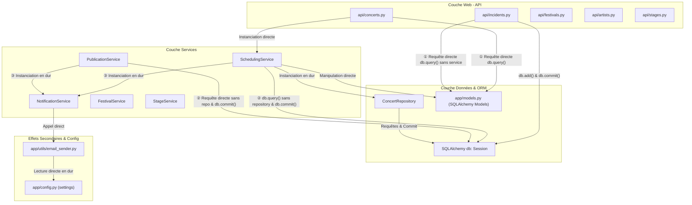

# Livrable Intermédiaire — Étape 1 : Diagnostic de l'Architecture Initiale (Legacy)

**Projet :** FestiPlan — Gestion d'un festival metal fictif (*Hellforge Open Air*)  
**Auteurs :** Hugo Cabanes (Développeur 1 — Planning & Scheduling) & Ewan Senergous (Développeur 2 — Référentiel & Logistique)  
**Contexte :** Module Architecture Hexagonale & DDD — Ynov B3  
**Dépôt de référence :** Commit initial `3a5aa55`, avant refactorisation  
**Schéma Draw.io associé :** [architecture-initiale.drawio](architecture-initiale.drawio) (les repères ①, ② et ③ ci-dessous renvoient à ses flèches)

---

## 1. Responsabilités des grandes parties du code initial

L'application initiale suit une organisation apparemment en couches (contrôleurs, services, dépôts, modèles ORM), mais sans étanchéité ni séparation nette des responsabilités :

| Dossier / Composant | Rôle théorique | Responsabilités réelles observées (Anomalies) |
| :--- | :--- | :--- |
| `main.py` | Point d'entrée de l'application. | Crée l'application FastAPI, monte les cinq routeurs et appelle `Base.metadata.create_all()` dès l'import du module, créant ainsi les tables en base au chargement. |
| `app/api/` (Routes HTTP) | Réception des requêtes HTTP, validation d'entrée et formatage des réponses. | **Mélange des genres :** en plus du routage, certains contrôleurs effectuent des requêtes SQL directes (`db.query(...)`), vérifient des règles métier (ex. `end_time <= start_time`), et transforment manuellement des chaînes CSV en listes d'équipements (`out(a)`). |
| `app/services/` (Services) | Orchestration de la logique applicative. | **Couplage fort et dispersion :** les services reçoivent la session SQLAlchemy (`db: Session`), instancient eux-mêmes en dur leurs dépendances techniques (`ConcertRepository(db)`, `NotificationService()`), déclenchent des `commit()` en base et appellent des effets secondaires (email). |
| `app/repositories/` (Dépôts) | Abstraction de l'accès aux données. | **Responsabilité transactionnelle mal placée :** les méthodes `create()` font un `self.db.commit()` et `self.db.refresh()`, privant la couche supérieure de la gestion transactionnelle globale (impossible de faire un rollback multi-opérations). Aucun repository pour les incidents. |
| `app/models.py` (Modèles ORM) | Représentation des tables relationnelles. | **Confusion Domaine / BDD :** ces classes SQLAlchemy servent à la fois de schéma relationnel, d'objets métier manipulés par les services, et de structures de données passées aux réponses HTTP. Les statuts sont des chaînes libres (`"preparation"`, `"published"`, `"scheduled"`, `"cancelled"`). |
| `app/schemas.py` (Schémas Pydantic) | DTOs de validation d'entrée/sortie API. | Contiennent des validations de format (longueur de chaînes, bornes), mais certaines règles métier y sont déléguées au lieu d'appartenir au domaine (ex. capacité d'une scène strictement positive). |
| `app/utils/` (Utilitaires) | Fonctions transverses. | `email_sender.py` simule l'envoi d'emails en dépendant directement du singleton global `settings` (`config.py`). `date_helpers.py` contient une fonction `overlaps` isolée hors de tout objet métier. |

---

## 2. Graphe des dépendances et couplage technique

### Schémas d'Architecture Initiale
Le couplage initial est documenté sous deux formes complémentaires :
* Le schéma Draw.io téléchargeable : **[architecture-initiale.drawio](architecture-initiale.drawio)**.
* Le diagramme de flux Mermaid ci-dessous, matérialisant les dépendances illégitimes :



### Analyse des Écarts et Raccourcis Observés
1. **① La route interroge directement la base :**
   * `concerts.py:18` et `:33` exécutent `db.query(Concert)`.
   * `incidents.py:11-23` lit, valide, crée et persiste directement en base sans aucun service applicatif.
2. **② Le service interroge la base sans passer par un repository :**
   * `scheduling_service.py:15` et `:26-28`, `publication_service.py:9`, `stage_service.py:12` contournent l'abstraction de persistance.
3. **③ Le service déclenche un effet de bord en dur :**
   * `scheduling_service` et `publication_service` instancient eux-mêmes un `NotificationService()`, qui appelle `email_sender`, couplé au singleton global `settings`.
4. **Couplage aux modèles ORM :**
   * Tous les services importent `app.models` et manipulent des entités SQLAlchemy (`Artist`, `Festival`, `Concert`). Il n'existe aucune représentation métier indépendante de la base.

---

## 3. Dispersion des règles métier

L'analyse du code montre que les 10 règles métier identifiées dans le sujet (**R1 à R10**) sont éparpillées sur plusieurs couches sans cohérence :

1. **Dans Pydantic (`app/schemas.py`) :**
   * Longueurs minimales et maximales des noms.
   * Capacité d'une scène strictement positive (**R9**), vérifiée uniquement ici et absente du modèle de données.
2. **Dans les routes HTTP (`app/api/`) :**
   * `incidents.py:11` : un incident doit viser un concert existant (**R10**).
   * `concerts.py:36` : l'heure de fin doit être après le début (**R1**), contrôle redondant refait ensuite dans le service.
3. **Dans les services (`app/services/`) :**
   * `festival_service.py:13` : un festival doit finir après avoir commencé.
   * `stage_service.py:12` : une scène doit être rattachée à un festival existant (**R4**).
   * `scheduling_service.create_concert` (lignes 26-41) : vérifie l'existence de la scène, du festival, de l'artiste (**R4**), les dates (**R6**), les conflits de scène (**R2**) et d'artiste (**R3**), et les équipements requis (**R5**).
4. **Dans un repository (`app/repositories/`) :**
   * `concert_repository.py:12` : les concerts annulés sont exclus du planning.
5. **Règles totalement absentes aux endroits critiques (Les Défauts) :**
   * `scheduling_service.reschedule_concert` (lignes 44-55) : **aucune** des règles R2, R3, R5, R6 et R7 n'est vérifiée lors du déplacement d'un concert ! Le concert est reprogrammé en base sans contrôle de conflit ou de disponibilité.
   * `publication_service.publish` : la règle **R8** (planning sans conflit avant publication) n'est jamais vérifiée.
6. **Code mort :**
   * `festival_service.publish()` (lignes 17-21) publie un festival, mais aucune route ne l'appelle : la route `/festivals/{id}/publish` utilise `publication_service`.

---

## 4. Dépendances directes à FastAPI et SQLAlchemy

Le cœur de l'application est prisonnier de ses choix technologiques :

1. **Intrusion omniprésente de SQLAlchemy :**
   * Toutes les méthodes des services attendent en paramètre `db: Session`.
   * Les objets manipulés par la logique métier sont des instances directes de `Base` SQLAlchemy (`app.models.Concert`, `app.models.Festival`), dotées de mécanismes d'instrumentation et de sessions actives (`dirty`, `flush`, `refresh`).
   * **Conséquence :** Aucun calcul métier ne peut s'effectuer sans charger SQLAlchemy en mémoire et instancier une base SQLite.
2. **Intrusion du web (FastAPI / HTTP) :**
   * Les erreurs métier sont souvent traduites directement en `HTTPException` dans le flux d'exécution, au lieu de lever des exceptions métier agnostiques du protocole web.
   * Les services communiquent avec les routes via des exceptions génériques (`ValueError` traduite en 400, `RuntimeError` en 500).

---

## 5. Problèmes de testabilité et risques d'incohérence

### A. Problèmes de testabilité
* **Absence d'injection de dépendances :** chaque service crée lui-même son repository et son service de notification dans son constructeur (`scheduling_service.py:9`, `publication_service.py:6`). Impossible de leur passer un bouchon ou un faux sans recourir au monkeypatching.
* **Base de données obligatoire :** les règles lisent la session SQLAlchemy ; tester une règle de planning nécessite donc une vraie base SQLite remplie.
* **Panne non simulable proprement :** pour faire échouer la notification, il faut modifier la variable globale d'environnement lue par `settings`.
* **Effets de bord à l'import :** importer `app.main` crée immédiatement les tables SQLite.
* **Tests existants insuffisants :** 6 tests seulement, tous exécutés à travers l'API complète (`TestClient`). Aucun ne couvrait les trois scénarios de défaillance du sujet.

### B. Risques majeurs d'incohérence (Les 3 Défauts du sujet)
1. **Défaut 1 — Incohérence des données du planning :**
   Lors d'un déplacement (`PATCH /concerts/{id}/reschedule`), aucun contrôle de chevauchement de scène ou d'artiste n'est réalisé. Un concert peut écraser le créneau d'un autre sans avertissement.
2. **Défaut 2 — Incohérence transactionnelle et notification post-commit :**
   Dans `reschedule_concert` et `publish`, le code effectue :
   ```python
   self.db.commit()               # Enregistrement persistant en base
   self.notifications.notify(...) # Appel réseau / externe
   ```
   Si l'envoi de notification échoue (ex. `fail_notifications=True`), une `RuntimeError` remonte et l'API répond **HTTP 500**. Le client pense que l'opération a échoué alors qu'elle a déjà été validée en base de données.
3. **Défaut 3 — Absence de protection du cycle de vie :**
   Le statut `status="published"` n'est qu'une chaîne libre non vérifiée lors du déplacement. Un concert peut être déplacé ou annulé arbitrairement dans un festival déjà publié.

---

## 6. Exemples concrets de responsabilités mal placées dans le code

### Exemple 1 : Le déplacement d'un concert réunit les 3 défauts
Dans `app/api/concerts.py:30-43` et `app/services/scheduling_service.py:44-55` :
```python
# Dans le contrôleur : accès direct à la base et règle métier dans la route
concert = db.query(Concert).filter(Concert.id == concert_id).first()
if payload.end_time <= payload.start_time:
    raise HTTPException(status_code=400, detail="Invalid time slot")

# Dans le service : seule règle vérifiée, commit direct puis notification
if payload.end_time <= payload.start_time:
    raise ValueError(...)
concert.start_time = payload.start_time
concert.end_time = payload.end_time
self.db.commit() # Données persistées
self.notifications.notify_schedule_change(...) # Si plantage ici -> HTTP 500 alors que commit OK
```

### Exemple 2 : Bypass complet de la couche service dans `app/api/incidents.py:9-16`
```python
@router.post("", response_model=IncidentRead, status_code=201)
def create_incident(payload: IncidentCreate, db: Session = Depends(get_db)):
    # ❌ Requête SQL brute directement dans le contrôleur HTTP
    if db.query(Concert).filter(Concert.id == payload.concert_id).first() is None: 
        raise HTTPException(status_code=404, detail="Concert introuvable")
    
    # ❌ Création et persistance directe sans règle métier ni cas d'usage
    row = Incident(concert_id=payload.concert_id,
                   description=payload.description,
                   occurred_at=payload.occurred_at)
    db.add(row); db.commit(); db.refresh(row)
    return row
```

### Exemple 3 : Parsing artisanal du format des données dans `app/api/artists.py:9-15`
```python
def out(a):
    return {
        "id": a.id,
        "name": a.name,
        "genre": a.genre,
        # ❌ Le contrôleur fait du parsing CSV pour pallier un défaut du schéma relationnel
        "required_equipment": [x for x in a.required_equipment.split(",") if x]
    }
```

---

## 7. Conclusion du diagnostic & Cible visée

L'application legacy souffre d'un **couplage direct à l'infrastructure** et d'une **absence de domaine métier autonome**.

La cible hexagonale mise en place :
1. **Domaine pur :** Objets-valeurs (`TimeSlot`), entités autonomes avec invariants (`Concert.check_conflict_with`), exceptions de domaine explicites, testables en mémoire sans framework.
2. **Ports abstraits :** `IConcertRepository`, `IFestivalQueryPort`, `INotificationSenderPort`.
3. **Cas d'usage applicatifs :** `RescheduleConcertUseCase` et `PublishFestivalUseCase` qui orchestrant les règles avant persistance et isolent les effets de bord (notifications tolérantes aux pannes).
4. **Adaptateurs interchangeables :** `ConcertSqlRepository` et `InMemoryConcertRepository`.

