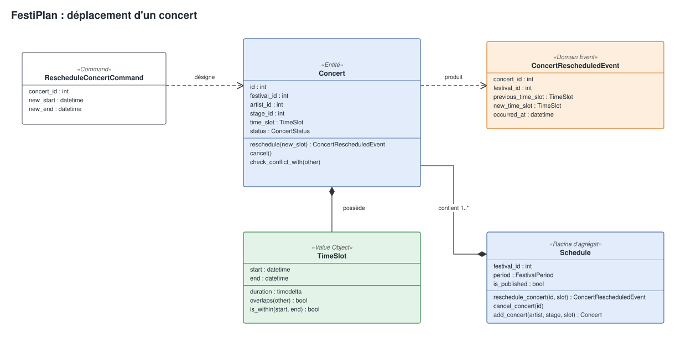

# Livrable Intermédiaire — Étape 2 : Modélisation Métier DDD (Domain-Driven Design)

**Projet :** FestiPlan — Gestion d'un festival metal fictif (*Hellforge Open Air*)  
**Auteur :** Hugo Cabanes (Développeur 1 — Planning & Scheduling)  
**Contexte :** Module Architecture Hexagonale & DDD — Ynov B3  
**Référence du sujet :** Consignes Étape 2 (p. 7-8 du sujet de synthèse)

---

## 1. Vue d'ensemble du Modèle Métier DDD

Dans l'architecture hexagonale, le **Domaine** constitue le cœur pur de l'application : il ne dépend ni d'une base de données relationnelle (SQLAlchemy), ni d'un protocole réseau (HTTP / FastAPI).

Pour structurer ce domaine et protéger nos règles métier, nous appliquons les concepts clés de **Domain-Driven Design (DDD)** :
* **Entités :** objets définis par leur identité propre et leur cycle de vie.
* **Objets-Valeurs (Value Objects) :** notions immuables définies par leurs attributs, auto-validées à la création.
* **Invariants :** règles de cohérence garanties à chaque instant.
* **Agrégats :** grappes d'objets délimitant les frontières de consistance transactionnelle.
* **Événements de Domaine :** faits métier accomplis permettant le découplage des effets secondaires.

---

## 2. Modélisation Conceptuelle du Domaine

Ce diagramme détaille le déplacement d'un concert. Le modèle complet, avec les cinq agrégats, est dans [modele-domaine.drawio](../schemas/modele-domaine.drawio).



Version modifiable : [modele_deplacement.drawio](../schemas/modele_deplacement.drawio).

---

## 3. Justification des Entités vs Objets-Valeurs

### 3.1 Les Entités (Identité & Cycle de Vie)

Une entité possède un identifiant unique qui persiste même si l'ensemble de ses attributs change. Deux entités ayant exactement les mêmes valeurs restent distinctes si leurs identifiants diffèrent.

- **`Concert`** ([concert.py](../../app/domain/models/concert.py)) : un même artiste peut jouer plusieurs concerts. Le concert a son propre cycle de vie, de programmé à annulé.
- **`Festival`** : événement global, dont le planning passe de préparation à publié, et peut être retiré.
- **`Artist`** : groupe invité, partagé entre festivals.
- **`Stage`** : espace rattaché à un festival, avec sa capacité et ses équipements.
- **`Incident`** : signalement horodaté rattaché à un concert, résolu une seule fois.

---

### 3.2 Les Objets-Valeurs / Value Objects (Immuabilité & Égalité structurelle)

Un objet-valeur n'a pas d'identité propre. Il est défini uniquement par les valeurs qu'il contient. Deux objets-valeurs possédant les mêmes attributs sont strictement interchangeables. Ils sont **immuables** (`frozen=True`) et garantissent leur propre validité dès leur instanciation.

#### 1. L'Objet-Valeur `TimeSlot` ([app/domain/value_objects/time_slot.py](../../app/domain/value_objects/time_slot.py))
* **Attributs :** `start: datetime`, `end: datetime`.
* **Pourquoi est-ce un Value Object ?** Un créneau *18h00 - 19h00* n'a pas d'ID en base. Si deux concerts ont lieu de 18h à 19h, ils partagent conceptuellement la même valeur temporelle.
* **Richesse comportementale :**
  * `duration` : calcul dynamique de la durée.
  * `overlaps(other)` : calcul pur d'intersection temporelle (`start_a < end_b and start_b < end_a`).
  * `is_within(start_limit, end_limit)` : vérification d'inclusion dans une période.

#### 2. L'Objet-Valeur `FestivalScheduleInfo` ([app/domain/ports/repositories/festival_repository_port.py](../../app/domain/ports/repositories/festival_repository_port.py))
* Modèle de lecture immuable transmettant les bornes temporelles et le statut `is_published` du festival au cas d'usage sans exposer l'ORM.

---

## 4. Définition et Localisation des Invariants

Un **invariant** est une règle de cohérence qui doit être vraie à tout instant pour qu'un objet métier soit dans un état valide.

DDD impose de placer chaque invariant **au plus près de la structure qui en a la responsabilité** :

- **R1, fin après début** : `TimeSlot.__post_init__`. Un créneau invalide ne peut pas exister.
- **Concert annulé non modifiable** : `Concert.reschedule()` et `Concert.cancel()`. L'entité protège son cycle de vie.
- **R2 et R3, conflits** : `Concert.check_conflict_with()`, appelée par `scheduling_policy.ensure_no_conflict()`. La règle compare plusieurs concerts.
- **R4 et R5, scène adaptée** : `scheduling_policy.ensure_stage_can_host()`, `Stage.belongs_to()` et `Stage.ensure_can_host()`.
- **R6, période du festival** : `scheduling_policy.ensure_within_festival()`. La règle confronte les agrégats `Festival` et `Concert`.
- **R7, planning publié** : `scheduling_policy.ensure_festival_is_modifiable()`. La procédure explicite est `Festival.unpublish()`.
- **R8, publication** : `scheduling_policy.ensure_publishable()`, appelée avant `Festival.publish()`.
- **R9, capacité** : `Stage.__post_init__`.
- **R10, incident** : `Incident.__post_init__` pour la description, `DeclareIncidentUseCase` pour l'existence du concert.

---

## 5. Définition des Frontières d'Agrégats (Aggregate Boundaries)

Un **agrégat** regroupe des objets métier soumis à des règles de cohérence communes. Sa **racine d'agrégat (Aggregate Root)** est le seul point d'entrée pour les modifications externes.

### Le choix de conception retenu

Deux approches étaient possibles.

1. **Un agrégat géant `Festival`**, contenant scènes et concerts. Les conflits seraient vérifiables dans un seul objet, mais toute modification chargerait et verrouillerait le planning entier.
2. **Des agrégats distincts référencés par identifiant**, solution retenue :
   - **`Festival`** : identité, période et cycle de publication.
   - **`Concert`** : créneau et statut, avec les identifiants du festival, de l'artiste et de la scène.
   - **`Stage`** : capacité et équipements, rattachée à un festival.
   - **`Artist`** : besoins techniques, partagé entre festivals.
   - **`Incident`** : description et résolution, rattaché à un concert.

### Justification de la frontière

- **Isolation** : un concert peut être déplacé ou annulé sans charger tout le festival.
- **Cohérence entre agrégats** : `RescheduleConcertUseCase` charge les concerts du festival et de l'artiste, puis `scheduling_policy` applique R2 et R3 avant l'enregistrement.
- **Limite assumée** : sans verrou en base, deux requêtes simultanées peuvent contourner ce contrôle. La [note d'architecture](03_note_architecture.md) détaille ce compromis.

---

## 6. Événements de Domaine (Domain Events) & Découplage

Le sujet insiste particulièrement sur la distinction de quatre concepts dans le flux de traitement :

```text
┌────────────────────────────┐
│ 1. Commande                │  Demande d'action explicite (intention)
│ RescheduleConcertCommand   │  Ex: "Déplacer le concert #1 de 14h à 15h"
└─────────────┬──────────────┘
              │
              ▼
┌────────────────────────────┐
│ 2. Cas d'Utilisation       │  Orchestration et application des invariants
│ RescheduleConcertUseCase   │  - Valide R1, R2, R3, R6, R7
└─────────────┬──────────────┘  - Persiste le nouvel état via IConcertRepository
              │
              ▼
┌────────────────────────────┐
│ 3. Événement de Domaine    │  Fait accompli immuable (passé)
│ ConcertRescheduledEvent    │  "Le concert #1 a été déplacé"
└─────────────┬──────────────┘
              │
              ▼
┌────────────────────────────┐
│ 4. Mécanisme Technique     │  Effet secondaire réactif non bloquant
│ EmailNotificationAdapter   │  Envoi d'un email de notification
└────────────────────────────┘
```

### Bénéfice immédiat (Résolution du Défaut 2)
Dans le code legacy, l'appel à la notification était directement imbriqué après le commit SQL, faisant crasher la requête en 500 en cas de défaillance réseau.  
En séparant clairement **le fait accompli** (`ConcertRescheduledEvent`) du **mécanisme technique réactif** (`INotificationSenderPort`), l'échec de la notification est traité comme un incident technique secondaire : il est consigné dans les logs sans annuler la réussite du cas d'usage, assurant une parfaite cohérence pour l'utilisateur.
