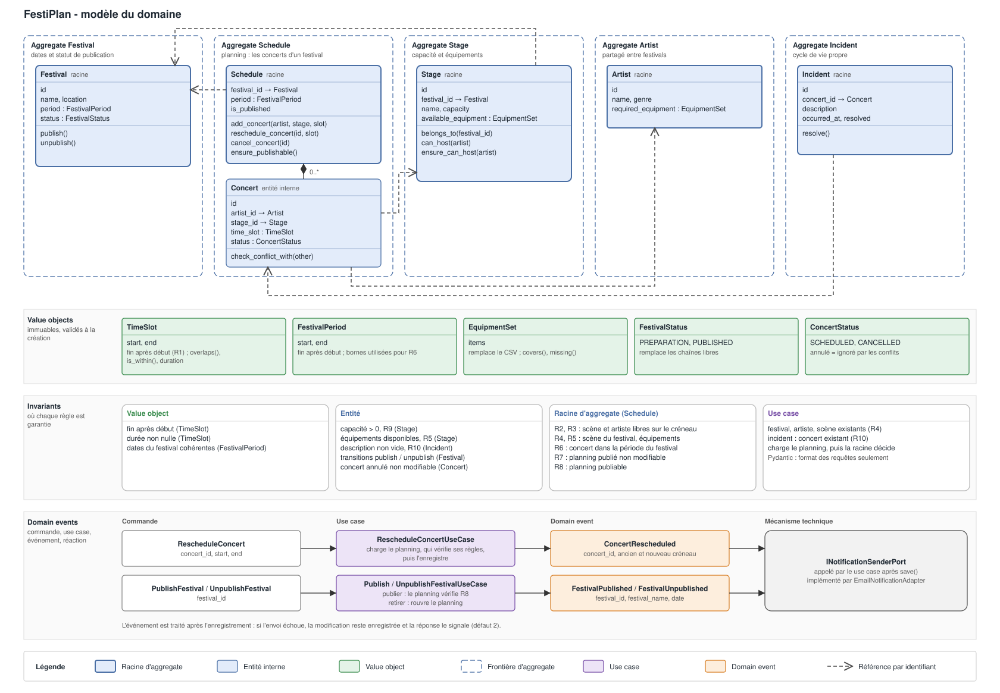

# Note d'architecture — FestiPlan

Cette note justifie la refactorisation de FestiPlan en architecture hexagonale, avec les concepts DDD utiles au projet. Elle décrit le code livré sur `feat/logistics-domain-usecases`.

> [!NOTE]
> **Lecture conseillée sur GitHub** : il est préférable de consulter ce document sur GitHub, où la présentation est meilleure et les schémas plus lisibles.

## Sommaire

1. Défauts de l'architecture initiale
2. Diagrammes UML
3. Responsabilités de chaque couche
4. Ports et adaptateurs
5. Modèle métier
6. Correction des trois défauts
7. Stratégie de tests
8. Limites et compromis
9. Patrons de conception

Documents associés : [diagnostic initial](01_diagnostic_initial.md), [modélisation DDD](02_modelisation_ddd.md), [reproduction des défauts](05_reproduction_defauts.md), [traçabilité des règles](04_regles_metier.md), [stratégie de tests](06_strategie_de_tests.md).

## 1. Défauts de l'architecture initiale

Le diagnostic complet figure dans le [livrable de l'étape 1](01_diagnostic_initial.md). Quatre problèmes ont guidé la refactorisation.

- **Couplage technique** : la `Session` SQLAlchemy et les modèles ORM traversaient les routes, les services et les repositories. Tester une règle demandait une base SQLite.
- **Responsabilités mal placées** : certaines routes interrogeaient la base, et les règles étaient réparties entre Pydantic, les routes et les services.
- **Dépendances instanciées en dur** : chaque service créait son repository et son service de notification, ce qui empêchait de les remplacer.
- **Effets de bord non isolés** : la notification partait après le commit, donc une panne produisait une erreur 500 alors que la donnée était enregistrée.

Le déplacement d'un concert réunissait ces problèmes : il ne vérifiait que l'ordre des dates. Les trois défauts du sujet ont été [reproduits sur le code initial](05_reproduction_defauts.md).

## 2. Diagrammes UML

### Diagramme de composants

La version modifiable est [diagramme_composants.drawio](../schemas/diagramme_composants.drawio).

Une requête arrive sur une route FastAPI. La route valide le format avec Pydantic, puis appelle un cas d'usage fourni par `app/composition.py`. Le cas d'usage s'appuie sur le domaine et sur des ports sortants. Les adaptateurs SQLAlchemy et email implémentent ces ports. Le sens des dépendances est vérifié par [test_architecture.py](../../tests/unit/test_architecture.py).

### Diagramme de séquence : déplacer un concert

Version modifiable : [diagramme_sequence.drawio](../schemas/diagramme_sequence.drawio).

## 3. Responsabilités de chaque couche

- **Domaine (`app/domain`)** : agrégats, entités, objets-valeurs, événements et exceptions métier. Il n'importe ni FastAPI, ni SQLAlchemy, ni Pydantic.
- **Application (`app/application`)** : cas d'usage. Chacun charge les données par les ports, appelle le domaine, enregistre le résultat puis déclenche les effets de bord.
- **Adaptateurs entrants (`app/adapters/primary`)** : routes FastAPI, schémas Pydantic et protections HTTP. Ils traduisent une requête en commande et une erreur métier en code HTTP.
- **Adaptateurs sortants (`app/adapters/secondary`)** : persistance SQLAlchemy, doubles en mémoire et notification.
- **Composition (`app/composition.py`)** : seul module qui crée les adaptateurs concrets et les injecte dans les cas d'usage.

Une règle est placée au plus près de ce qu'elle protège. Un créneau invalide n'a pas de sens, donc `TimeSlot` le refuse à sa création. Un conflit compare plusieurs concerts, donc il relève du planning `Schedule`, la racine qui les contient. Vérifier qu'un artiste existe nécessite un accès aux données, donc le cas d'usage s'en charge. Pydantic ne contrôle que le format des requêtes.

Les codes HTTP suivent une règle unique. Le code 400 signale des données contraires à une règle métier, 404 une ressource absente, 409 un conflit avec l'état du planning, et 422 un format de requête invalide.

## 4. Ports et adaptateurs

### Ports entrants

Définis dans [inbound.py](../../app/application/ports/inbound.py), ils décrivent les commandes métier principales : `IScheduleConcertPort`, `IRescheduleConcertPort`, `IPublishFestivalPort`, `IUnpublishFestivalPort` et `IDeclareIncidentPort`.

Les lectures simples, les créations du référentiel et l'annulation appellent directement leur cas d'usage. Une interface supplémentaire n'y protégerait aucune variation réelle. [test_inbound_ports.py](../../tests/integration/test_inbound_ports.py) vérifie qu'une route accepte toute implémentation de son port.

### Ports sortants

| Port | Production | Double de test |
|---|---|---|
| `IScheduleRepository` | `ScheduleSqlRepository` | `InMemoryScheduleRepository` |
| `IConcertQueryPort` | `ConcertSqlQueryAdapter` | `InMemoryConcertQueryAdapter` |
| `IFestivalRepository` | `FestivalSqlRepository` | `InMemoryFestivalRepository` |
| `IStageRepository` | `StageSqlRepository` | `InMemoryStageRepository` |
| `IArtistRepository` | `ArtistSqlRepository` | `InMemoryArtistRepository` |
| `IIncidentRepository` | `IncidentSqlRepository` | `InMemoryIncidentRepository` |
| `INotificationSenderPort` | `EmailNotificationAdapter` | `FakeNotificationAdapter` |

Les repositories isolent le stockage et permettent de tester les cas d'usage sans base. `IScheduleRepository` charge et enregistre le planning entier en une transaction : c'est le seul chemin d'écriture des concerts. `IConcertQueryPort` est réservé à la lecture : consultation, incidents, et concerts d'un artiste dans les autres festivals. `INotificationSenderPort` reçoit des événements métier, ce qui permet de simuler une panne sans réseau.

## 5. Modèle métier

Version modifiable : [modele-domaine.drawio](../schemas/modele-domaine.drawio).

### Entités

`Festival`, `Schedule`, `Concert`, `Stage`, `Artist` et `Incident` possèdent une identité : deux concerts aux mêmes horaires restent distincts, car les entités ne sont pas comparées par la valeur de leurs champs. Le planning `Schedule` est identifié par son festival.

### Objets-valeurs

- `TimeSlot` : créneau immuable, garantit R1 et calcule les chevauchements.
- `FestivalPeriod` : période immuable d'un festival.
- `EquipmentSet` : ensemble d'équipements qui remplace la manipulation de texte CSV.
- `FestivalStatus` et `ConcertStatus` : statuts fermés qui remplacent les chaînes libres.

### Invariants

- **Objet-valeur** : R1 et cohérence des dates du festival.
- **Entité** : R9 et R5 sur `Stage`, R10 sur `Incident`, transitions de `Festival` et interdiction de modifier un concert annulé.
- **Racine d'agrégat** : R2 à R8 dans `Schedule`, qui contient les concerts que ces règles comparent.
- **Cas d'usage** : existence des références (R4 et R10) et chargement des concerts de l'artiste dans les autres festivals, car ils demandent un accès aux données.

### Agrégats

Le modèle compte cinq agrégats, qui se référencent par identifiant : `Schedule`, `Festival`, `Stage`, `Artist` et `Incident`. Le sujet demande de ne pas tout placer dans un seul agrégat, ni de créer un agrégat par classe : la frontière suit donc les règles à garantir.

`Schedule`, le planning d'un festival, est la racine qui contient les concerts. R2, R3, R6 et R7 portent sur l'ensemble de ces concerts ; elles ne peuvent être garanties que par un objet qui les voit tous. Programmer, déplacer et annuler passent donc par `Schedule`, et il n'existe pas de repository de concert : `IScheduleRepository` enregistre le planning entier.

Les autres agrégats restent séparés, car aucune règle ne les lie dans la même transaction. Un agrégat `Festival` contenant aussi les scènes aurait obligé à charger tout le festival pour créer une scène, et `Artist` ne peut pas lui appartenir, car un artiste est partagé entre festivals. `Stage` et `Artist` sont passés en paramètre au planning pour R4 et R5.

Ce découpage garde deux coûts, décrits en section 8 : chaque modification charge tous les concerts du festival, et R3 entre festivals croise deux plannings, donc le cas d'usage fournit à la racine les concerts de l'artiste ailleurs.

### Contextes métier

Le code distingue trois sous-domaines : planification, référentiel et opérations. La planification, qui porte l'essentiel des règles (R1 à R8), est le sous-domaine cœur ; le référentiel et les incidents sont des sous-domaines de support. Ils partagent un seul modèle et une seule base, donc un seul contexte borné. Séparer davantage ces contextes ajouterait des traductions sans besoin réel pour un monolithe de cette taille.

### Niveau de DDD retenu

Le projet applique le DDD tactique (entités, objets-valeurs, agrégats, invariants, événements) là où les règles le justifient, c'est-à-dire sur le planning : R2, R3, R6 et R7 croisent plusieurs concerts, et une erreur y crée un planning incohérent. Le référentiel est proche d'un CRUD : ses entités restent simples et portent seulement quelques invariants. Côté stratégique, le projet se limite aux sous-domaines et au langage commun, car une cartographie de plusieurs contextes serait disproportionnée.

### Commande, cas d'usage, résultat, événement, réaction

Pour un déplacement, `RescheduleConcertCommand` exprime la demande, `RescheduleConcertUseCase` l'orchestre, `ConcertRescheduledEvent` décrit le fait accompli, et `EmailNotificationAdapter` y réagit à travers `INotificationSenderPort`. `RescheduleConcertResult` est ce que l'opération retourne : le concert déplacé et l'état de la notification. Une commande peut échouer, alors que l'événement n'est traité qu'une fois le fait enregistré. `FestivalPublishedEvent` et `FestivalUnpublishedEvent` suivent le même principe.

## 6. Correction des trois défauts

Le détail des requêtes et des résultats, avant et après, figure dans [05_reproduction_defauts.md](05_reproduction_defauts.md).

### Défaut 1 : conflits de programmation

`ScheduleConcertUseCase` et `RescheduleConcertUseCase` passent par la même racine `Schedule`, donc par les mêmes règles. Le déplacement vérifie les conflits sur une copie du concert, face aux autres concerts du planning et à ceux de l'artiste, puis seulement modifie le concert réel. Un conflit renvoie 409.

R3 est contrôlée entre festivals, car un artiste ne peut pas être à deux endroits en même temps.

### Défaut 2 : notification en échec

Le déplacement et la publication sont les opérations métier ; la notification est un effet de bord. Elle part après `save()`. Si elle échoue, l'exception est journalisée, la modification reste enregistrée, et l'API répond 200 avec `notification_sent: false`.

Le client sait ainsi que l'opération a réussi et que l'alerte n'est pas partie. Une file de messages n'a pas été retenue, car elle serait disproportionnée pour ce projet.

### Défaut 3 : planning publié

`FestivalStatus` représente l'état du planning, et `Festival` porte les transitions `publish()` et `unpublish()`.

La règle retenue est le refus suivi d'une dépublication explicite. Programmer, déplacer ou annuler un concert d'un festival publié renvoie 409. `POST /festivals/{id}/unpublish` remet le planning en préparation et prévient les équipes. Une nouvelle publication repasse par tous les contrôles de R8.

## 7. Stratégie de tests

La suite compte 257 tests, tous au vert. Le détail est dans [06_strategie_de_tests.md](06_strategie_de_tests.md).

- **Domaine** : 92 tests, sans FastAPI ni SQLite.
- **Cas d'usage** : 63 tests avec des doubles de test.
- **Adaptateurs** : 54 tests sur les routes, SQLite et la notification.
- **Non-régression** : 19 tests HTTP sur les défauts et les erreurs corrigées.
- **Autres** : 19 tests de sécurité, 6 tests de l'API initiale et 4 tests du sens des dépendances.

Les 4 tests HTTP des trois défauts échouent sur le code initial et passent sur le code livré.

## 8. Limites et compromis

- **Concurrence** : les conflits sont vérifiés puis enregistrés sans verrou ni contrainte en base. Deux requêtes simultanées peuvent donc créer un chevauchement, ou déplacer un concert pendant une publication. Un numéro de version sur le planning, vérifié à l'enregistrement, le corrigerait : l'agrégat fournit l'endroit où le poser.
- **Taille du planning** : chaque modification charge tous les concerts du festival. C'est le prix d'une racine qui garantit R2 et R3, acceptable pour quelques centaines de concerts.
- **Notification** : l'envoi reste synchrone et n'est pas retenté. Une notification en échec est signalée mais perdue. Une table outbox et un worker seraient la suite logique.
- **Validation de l'enregistrement** : chaque `save()` valide sa transaction. C'est suffisant ici, car chaque cas d'usage modifie un seul agrégat ; une opération sur plusieurs agrégats nécessiterait une unité de travail.
- **Entités mutables** : les invariants d'entité sont vérifiés à la création et dans les méthodes métier, mais un attribut comme `Stage.capacity` reste modifiable directement. `Schedule.concerts` est un tuple en lecture seule, donc aucun concert n'entre dans le planning sans passer par sa racine. En revanche, un `Concert` obtenu du planning reste un objet modifiable : seule la convention impose de passer par `Schedule.reschedule_concert()`.
- **État de publication** : il appartient à `Festival`, car la publication est une transition du festival entier, consultée aussi sans charger ses concerts. Le planning en lit une copie au chargement pour appliquer R7. En contrepartie, publier et déplacer touchent deux agrégats : c'est l'un des cas de concurrence décrits ci-dessus.
- **Modification après publication** : il n'existe que la dépublication. Une procédure d'urgence ciblant un seul concert serait un ajout métier distinct.
- **Emplacement des ports** : les ports sortants sont dans le domaine et les ports entrants dans l'application. Ils pourraient être regroupés sans changer le sens des dépendances.
- **Schéma de base** : les tables sont créées par `create_all()`, sans migrations. Les équipements restent stockés en texte, convertis par l'adaptateur SQL (`equipment_csv.py`) : le format de stockage ne remonte pas dans le domaine.
- **Hors périmètre** : l'API n'a ni authentification ni gestion des rôles.

## 9. Patrons de conception

- **Repository** : isole la persistance derrière un contrat.
- **Adapter** : traduit les contrats des ports vers SQLAlchemy et l'envoi d'emails.
- **Value Object** : donne un sens et une validation aux créneaux, périodes et équipements.
- **Domain Event** : décrit un fait accompli sans coupler le domaine à la notification.
- **Command** : porte une intention métier indépendante du format HTTP.
- **Aggregate** : `Schedule` regroupe les concerts d'un festival et garantit leurs règles communes.
- **Composition Root** : `app/composition.py` assemble les dépendances à un seul endroit.
- **DTO** : les schémas Pydantic séparent le contrat de l'API du modèle métier.
- **Middleware** : ajoute les en-têtes de sécurité sans toucher au cœur applicatif.
