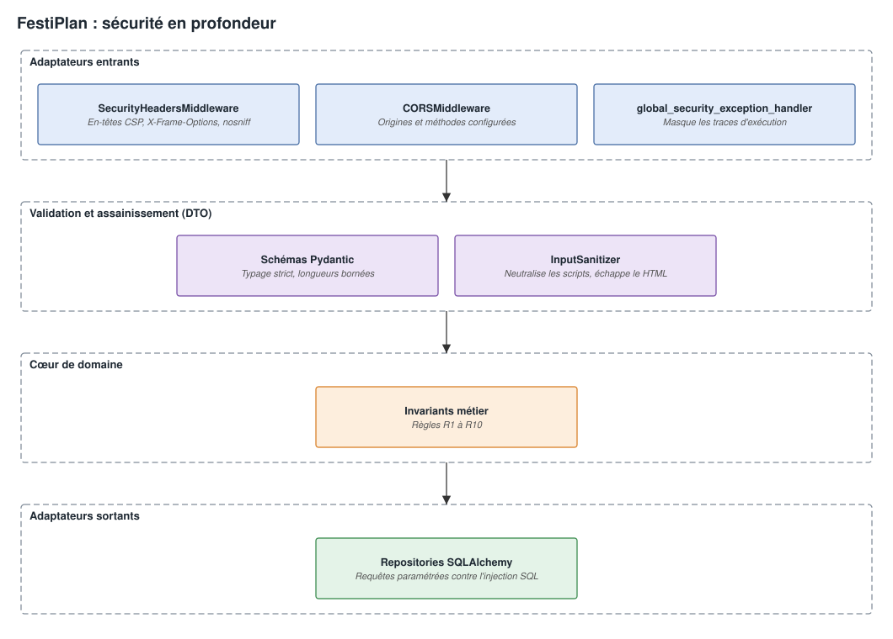

# Dossier d'Ingénierie Cybersécurité & Hardening — FestiPlan

**Projet :** FestiPlan — API de Gestion de Festival  
**Contexte :** Renforcement de la sécurité applicative (Sécurité en Profondeur dans l'Architecture Hexagonale)  
**Pôles contributeurs :** Initialement conçu par Développeur 3 (Opérations), puis étendu et généralisé par Développeur 2 (Logistique) et Développeur 1 (Planification)  
**Référence des menaces :** OWASP Top 10 (2021)  

> [!NOTE]
> **Lecture conseillée sur GitHub** : il est préférable de consulter ce document sur GitHub, où la présentation est meilleure et les schémas plus lisibles.

---

## 1. Pourquoi la Cybersécurité dans FestiPlan ?

Bien que le sujet académique initial se concentre sur l'architecture hexagonale et DDD, **une application d'entreprise ne peut pas dissocier qualité architecturale et sécurité**.

Dans l'état initial (legacy), plusieurs faiblesses techniques laissaient entrevoir des risques majeurs :
1. **Absence totale d'en-têtes HTTP de sécurité :** Vulnérabilité au Clickjacking (`X-Frame-Options` absent) et au MIME-type sniffing (`X-Content-Type-Options` absent).
2. **Risque de Stored XSS (Cross-Site Scripting) :** Aucune neutralisation des balises ``, ``) stockés en base puis réaffichés dans le navigateur d'un organisateur ou festivalier.
* **Remédiation :**
  * Le composant `InputSanitizer.sanitize_text()` est branché via des `@field_validator` sur tous les DTOs textuels (`IncidentCreate`, `FestivalCreateRequest`, `ArtistCreateRequest`, `StageCreateRequest`).
  * Les balises `<script>` sont éradiquées et les chevrons convertis en entités HTML (`&lt;`, `&gt;`).
* **Preuve par les tests :** 4 tests automatisés dédiés valident que l'injection de scripts sur les incidents, festivals, artistes et scènes est systématiquement neutralisée.

---

### 4.3 Prévention des Fuites d'Informations (OWASP A05 — Security Misconfiguration)
* **Menace :** En cas d'erreur inattendue (panne SQLite, bug, indisponibilité système), renvoi de la stack trace complète dévoilant l'arborescence des disques de la machine hôte (`C:\Users\...`), les requêtes SQL internes et la configuration.
* **Remédiation :**
  * Le gestionnaire `global_security_exception_handler` capture les exceptions inattendues.
  * L'erreur est logguée avec son contexte côté serveur uniquement.
  * Le client HTTP reçoit une réponse **HTTP 500** anonymisée : `{"detail": "Une erreur interne sécurisée est survenue. Aucun détail technique sensible n'est divulgué.", "status": "error"}`.
* **Preuve par les tests :** `test_unhandled_exception_does_not_leak_system_paths` valide l'absence absolue de tout chemin de fichier système dans la réponse retournée au client.

---

### 4.4 En-têtes HTTP de Sécurité (OWASP Security Headers)
* **Menace :** Clickjacking, écoute de trafic et attaques MIME Sniffing.
* **Remédiation :**
  * Le middleware `SecurityHeadersMiddleware` injecte sur **toutes les réponses HTTP** :
    * `X-Content-Type-Options: nosniff` (bloque le sniffing de type MIME)
    * `X-Frame-Options: DENY` (protection anti-clickjacking)
    * `X-XSS-Protection: 1; mode=block`
    * `Referrer-Policy: strict-origin-when-cross-origin`
    * `Permissions-Policy: geolocation=(), microphone=(), camera=()`
    * `Content-Security-Policy: default-src 'self'; ...` (configuré pour autoriser l'affichage propre de Swagger UI tout en protégeant l'application).
* **Preuve par les tests :** `test_security_headers_present_on_endpoints` contrôle la présence effective de ces en-têtes sur l'ensemble des endpoints.

---

### 4.5 Protection Anti-DoS par Dépassement de Capacité
* **Menace :** Saturation mémoire ou disque par soumission de payloads textuels massifs (plusieurs dizaines de mégaoctets).
* **Remédiation :**
  * Bornage strict `max_length=2000` sur les descriptions d'incidents, et de 80 à 120 caractères sur les noms, genres et lieux.
  * Identifiants et capacités limités à l'entier 64 bits stocké par SQLite (`EntityId`), pour qu'une valeur démesurée soit un format invalide et non une erreur 500.
* **Preuve par les tests :** `test_oversized_payload_rejected`, `test_too_large_id_in_url_is_rejected` et `test_too_large_int_in_body_is_rejected` valident le rejet immédiat avec code **HTTP 422** en cas de dépassement.

---

## 5. Bilan de la Couverture de Sécurité

La sécurité du projet est validée par **22 tests automatisés directs** intégrés aux **257 tests globaux** :

| # | Test | Fichier | Objectif de sécurité | Résultat |
| :---: | :--- | :--- | :--- | :---: |
| 1 | `test_security_headers_present_on_endpoints` | `tests/security/` | Présence des en-têtes OWASP (`nosniff`, `DENY`, CSP). | **PASSED** |
| 2 | `test_sqli_in_query_parameters_fails_safe[1 OR 1=1]` | `tests/security/` | Typage strict anti-SQLi dans les query params. | **PASSED** |
| 3 | `test_sqli_in_query_parameters_fails_safe[1' OR '1'='1]` | `tests/security/` | Typage strict anti-SQLi dans les query params. | **PASSED** |
| 4 | `test_sqli_in_query_parameters_fails_safe[DROP TABLE]` | `tests/security/` | Typage strict anti-SQLi dans les query params. | **PASSED** |
| 5 | `test_sqli_in_query_parameters_fails_safe[UNION SELECT]` | `tests/security/` | Typage strict anti-SQLi dans les query params. | **PASSED** |
| 6 | `test_sqli_payload_in_text_body_is_safely_parameterized` | `tests/security/` | Paramétrage sécurisé des champs textuels SQL. | **PASSED** |
| 7 | `test_input_sanitizer_unit` | `tests/security/` | Test unitaire de neutralisation des balises HTML et scripts. | **PASSED** |
| 8 | `test_xss_injection_in_incident_description_is_sanitized` | `tests/security/` | Élimination des scripts XSS dans les incidents (Dev 3). | **PASSED** |
| 9 | `test_oversized_payload_rejected` | `tests/security/` | Rejet HTTP 422 des charges surdimensionnées (Anti-DoS). | **PASSED** |
| 10 | `test_unhandled_exception_does_not_leak_system_paths` | `tests/security/` | Masquage des chemins système et stack traces lors d'un crash 500. | **PASSED** |
| 11 | `test_input_sanitizer_keeps_legitimate_punctuation[Guns N' Roses]` | `tests/security/` | Conservation de la ponctuation légitime. | **PASSED** |
| 12 | `test_input_sanitizer_keeps_legitimate_punctuation[Rock & Metal]` | `tests/security/` | Conservation de la ponctuation légitime. | **PASSED** |
| 13 | `test_input_sanitizer_keeps_legitimate_punctuation[Le "Grand" Soir]` | `tests/security/` | Conservation de la ponctuation légitime. | **PASSED** |
| 14 | `test_input_sanitizer_is_idempotent` | `tests/security/` | Un double assainissement ne modifie plus le texte. | **PASSED** |
| 15 | `test_festival_text_fields_are_sanitized` | `tests/integration/` | Assainissement XSS des champs festivals (Dev 2). | **PASSED** |
| 16 | `test_artist_text_fields_are_sanitized` | `tests/integration/` | Assainissement XSS des champs artistes (Dev 2). | **PASSED** |
| 17 | `test_stage_name_is_sanitized` | `tests/integration/` | Assainissement XSS des champs scènes (Dev 2). | **PASSED** |
| 18 | `test_input_sanitizer_keeps_legitimate_punctuation[Bonjour=1]` | `tests/security/` | Un `=` dans un mot ordinaire n'est pas pris pour un gestionnaire d'événement. | **PASSED** |
| 19 | `test_input_sanitizer_removes_event_handlers` | `tests/security/` | Suppression des gestionnaires d'événements (`onerror=`). | **PASSED** |
| 20 | `test_too_large_id_in_url_is_rejected` | `tests/security/` | Rejet HTTP 422 d'un identifiant hors limites dans l'URL. | **PASSED** |
| 21 | `test_too_large_int_in_body_is_rejected` | `tests/security/` | Rejet HTTP 422 d'un entier hors limites dans le corps. | **PASSED** |
| 22 | `test_largest_storable_id_is_simply_not_found` | `tests/security/` | Le plus grand identifiant stockable reste un simple 404. | **PASSED** |

---

## 6. Synthèse

Le durcissement de sécurité n'est plus limité au seul périmètre initial du Développeur 3 : il s'agit désormais d'une **démarche globale et transversale**, intégrée dans tous les schémas d'entrée des trois développeurs, protégée par l'architecture hexagonale et vérifiée par les 257 tests automatisés du projet.
