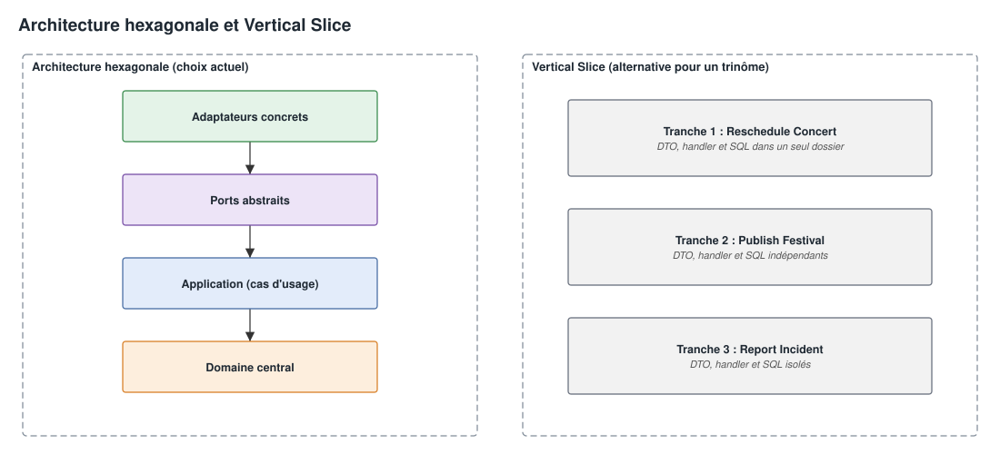

# Rétrospective, Analyse Critique & Guide des Bonnes Pratiques — FestiPlan

**Projet :** FestiPlan — Gestion de Festival de Musique  
**Module :** Architecture Hexagonale & DDD — Ynov B3  
**Document :** Rétrospective d'ingénierie, analyse comparative des architectures et pistes pour la suite  

> [!NOTE]
> **Lecture conseillée sur GitHub** : il est préférable de consulter ce document sur GitHub, où la présentation est meilleure et les schémas plus lisibles.

---

## 1. Introduction

Ce document dresse le bilan technique de FestiPlan : ses forces, ses limites restantes, les architectures qui auraient pu convenir et les pratiques à reprendre sur un prochain projet d'équipe.

---

## 2. Bilan du projet

### Points forts
* **Domaine indépendant des frameworks :** Les entités (`Concert`, `Incident`) et objets-valeurs (`TimeSlot`) ne connaissent aucun framework. Aucune dépendance à FastAPI, Pydantic ou SQLAlchemy dans `app/domain/`.
* **Inversion de dépendance (Ports & Adapters) :** Les cas d'usage dépendent de contrats abstraits (`typing.Protocol`), ce qui permet de remplacer la persistance SQLite par des dépôts en mémoire dans les tests.
* **Pyramide de tests (257 tests) :**
  * 92 tests unitaires de domaine sans framework.
  * 63 tests de cas d'usage avec des doubles de test.
  * 54 tests d'adaptateurs avec FastAPI et SQLite.
  * 19 tests HTTP de non-régression.
  * 19 tests de sécurité.
  * 6 tests de l'API initiale et 4 tests du sens des dépendances.
* **Résolution des 3 défauts initiaux, vérifiée par les tests :**
  * *Défaut 1 (Conflits de scène et d'artiste) :* Un déplacement ou une programmation en conflit est refusé, hors accès concurrents (voir ci-dessous).
  * *Défaut 2 (Panne de notification) :* La modification reste enregistrée, et la réponse signale que l'alerte n'est pas partie.
  * *Défaut 3 (Verrouillage du planning) :* Une modification ordinaire d'un festival publié est refusée.
* **Patrons de conception :** Repository, Value Object, Adapter, Domain Event, Command, Aggregate, Composition Root, Middleware et DTO, justifiés dans la note d'architecture ([`03_note_architecture.md`](03_note_architecture.md#9-patrons-de-conception)).

### Faiblesses et dettes techniques restantes
1. **Absence de gestion de la concurrence :**
   Si deux organisateurs programment au même moment deux concerts sur la même scène, les deux requêtes peuvent passer les vérifications avant que le commit ne soit finalisé. Il manque un verrouillage optimiste, avec un numéro de version sur l'agrégat, ou un verrouillage pessimiste au niveau SQL.
2. **Initialisation de la base par `create_all()` :**
   L'application utilise encore `Base.metadata.create_all(bind=engine)` au démarrage, ce qui ne permet pas de faire évoluer le schéma par migrations.
3. **Absence d'authentification et de contrôle d'accès :**
   Tous les endpoints sont publics. N'importe quel client HTTP peut publier le festival, déplacer des concerts ou déclarer des incidents.
4. **Effets secondaires synchrones :**
   L'échec de notification n'annule plus la modification, mais l'envoi reste exécuté pendant la requête HTTP. Un service d'envoi lent ralentirait donc la réponse.

---

## 3. Le projet aurait-il pu être mieux conçu ?

Quatre évolutions renforceraient la conception. Elles ajoutent aussi de la complexité, que la taille du projet ne justifiait pas.

### Gestion des événements
- **Actuellement** : la notification est appelée directement dans le cas d'usage (`notify_concert_rescheduled(event)`).
- **Évolution** : un outbox, où l'événement est enregistré dans la même transaction que le concert, puis traité par un worker.
- **Bénéfice** : une notification en échec peut être retentée, et la requête HTTP n'attend plus l'envoi.

### Gestion de la concurrence
- **Actuellement** : vérification en lecture, puis écriture (`get_by_concert_id` puis `save`).
- **Évolution** : un champ `version` sur le planning, contrôlé au moment de l'enregistrement.
- **Bénéfice** : de deux modifications simultanées d'un même planning, la seconde est refusée au lieu d'écraser la première.

### Migrations de la base
- **Actuellement** : `create_all()` au démarrage.
- **Évolution** : Alembic, avec des migrations versionnées dans Git.
- **Bénéfice** : le schéma peut évoluer sans supprimer la base.

### Séparation des lectures et des écritures
- **Actuellement** : les lectures et les écritures partagent le même modèle (`Concert`).
- **Évolution** : un CQRS léger, avec des modèles de lecture distincts.
- **Bénéfice** : un code de lecture plus simple, sans charger d'entités complètes.

---

## 4. Une autre architecture aurait-elle été plus adaptée ?

L'**Architecture Hexagonale (Ports & Adapters)** était imposée par le module, et elle a rempli son rôle en séparant le domaine de l'infrastructure. D'autres architectures auraient présenté des avantages :

Version modifiable : [architectures_comparees.drawio](../schemas/architectures_comparees.drawio).

### 1. Vertical Slice Architecture (Architecture en Tranches Verticales)
* **Principe :** Au lieu de découper horizontalement en couches techniques (`domain`, `application`, `adapters`, `repositories`), on découpe verticalement par **cas d'utilisation métier** (ex. `features/scheduling/reschedule_concert/`). Chaque tranche contient son DTO, son handler de commande et sa requête SQL.
* **Ce qu'elle aurait apporté ici :**
  * **Moins de conflits Git :** chaque développeur travaille dans son dossier de fonctionnalités et touche moins souvent aux mêmes fichiers.
  * **Moins d'abstractions :** une simple lecture ne demande pas de créer une interface et une implémentation.

### 2. Modular Monolith (Monolithe Modulaire)
* **Principe :** Structurer l'application en 3 modules autonomes (`scheduling_module`, `logistics_module`, `operations_module`), chacun avec son hexagone et ses tables, qui communiquent par des événements de domaine.
* **Intérêt :** Prépare une migration ultérieure vers des microservices sans en subir la complexité réseau au départ.

### En conclusion sur l'architecture
L'Architecture Hexagonale est adaptée au cœur métier complexe, notamment au calcul des conflits de scènes et d'artistes. Une organisation par tranches verticales aurait pu simplifier le référentiel, qui est proche d'un CRUD, et faciliter la répartition du travail.

---

## 5. Pour aller en production

* **Authentification et rôles :** JWT ou OAuth2, des rôles distincts pour publier, déplacer un concert et consulter le planning, et une limitation du débit.
* **Interface de consultation :** Swagger est un outil de développeur ; des organisateurs auraient besoin d'une grille horaire par scène.
* **Outillage :** Docker Compose et un `Makefile` pour installer, initialiser, tester et lancer le projet.

---

## 6. Pratiques à reprendre sur un prochain projet

1. **Convention de commits dès le départ :** le format `<gitmoji> <type>(<pôle>): <description>`, décrit dans [CONTRIBUTING.md](../../CONTRIBUTING.md).
2. **Protection des branches :** `main` stable, une branche d'intégration, et des fusions par pull request avec les tests au vert.
3. **Vérifications automatiques :** ruff et pytest lancés sur chaque push, dès le premier commit.
4. **Contrats communs d'abord :** écrire ensemble les ports le premier jour, puis développer chacun avec des doubles en mémoire, sans attendre les tables SQL des autres.
5. **Environnement identique :** une même version de Python et un Docker Compose commun évitent les écarts entre les postes.
