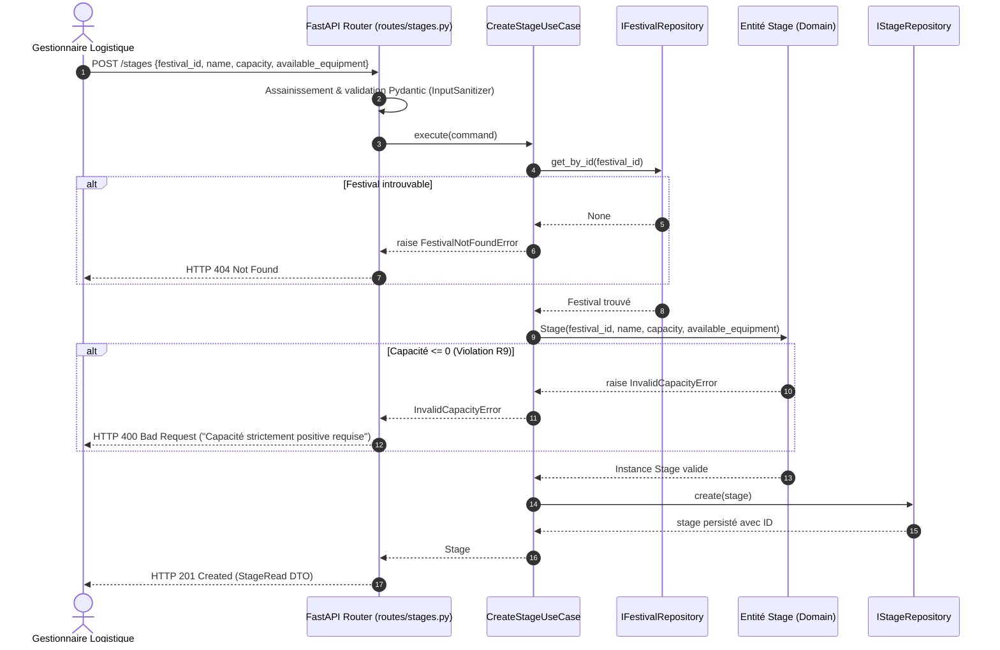

# Note d'Architecture & Choix Techniques — Pôle Référentiel & Logistique (Développeur 2)

**Projet :** FestiPlan — Refactorisation en Architecture Hexagonale & DDD  
**Auteur du pôle :** Ewan Senergous (Développeur 2 — Référentiel, Festivals, Artistes & Scènes)  
**Contexte :** Module Architecture Hexagonale — Ynov B3  
**Références :** Consignes des étapes 1 à 6 et livrables finaux attendus (sujet de synthèse)

---

## 1. Vue d'Ensemble & Objectifs du Pôle Développeur 2

Le pôle **Référentiel & Logistique** constitue le socle fondamental sur lequel reposent la programmation (Développeur 1) et les opérations (Développeur 3). Il gère le cycle de vie des entités maîtresses de l'événementiel :
1. **Les Festivals :** Définition de l'événement, localisation, période temporelle stricte (`FestivalPeriod`) et statut (`FestivalStatus`).
2. **Les Artistes :** Fiche d'identité musicale et modélisation formelle des exigences techniques scéniques via le Value Object `EquipmentSet`.
3. **Les Scènes :** Espaces physiques d'accueil caractérisés par leur festival de rattachement (**R4**), leur capacité d'accueil strictement positive (**R9**) et leur dotation matérielle face aux exigences des artistes (**R5**).

---

## 2. Diagramme UML de Composants (Pôle Logistique)

Le diagramme suivant illustre l'architecture hexagonale du pôle logistique, démontrant le respect strict de l'inversion de dépendance via les ports de persistance :

```mermaid
graph TB
    subgraph Driving_Adapters ["Adaptateurs Entrants (Driving / Primary Adapters)"]
        API_Festivals["FastAPI Router<br><b>routes/festivals.py</b><br><i>GET, POST, GET /{id}</i>"]
        API_Artists["FastAPI Router<br><b>routes/artists.py</b><br><i>GET, POST</i>"]
        API_Stages["FastAPI Router<br><b>routes/stages.py</b><br><i>GET, POST</i>"]
        DTO_Schemas["Pydantic Schemas & Sanitizers<br><b>FestivalSchemas / ArtistSchemas / StageSchemas</b>"]
    end

    subgraph Application_Layer ["Couche Application (Use Cases)"]
        UC_CreateFest["<b>CreateFestivalUseCase</b>"]
        UC_GetFest["<b>GetFestivalUseCase</b>"]
        UC_ListFest["<b>ListFestivalsUseCase</b>"]
        UC_CreateArtist["<b>CreateArtistUseCase</b>"]
        UC_ListArtists["<b>ListArtistsUseCase</b>"]
        UC_CreateStage["<b>CreateStageUseCase</b>"]
        UC_ListStages["<b>ListStagesUseCase</b>"]
    end

    subgraph Domain_Core ["Cœur de Domaine DDD (Domain Core)"]
        Entity_Festival["Entité Pure<br><b>Festival</b><br><i>name, location, period, status</i>"]
        Entity_Artist["Entité Pure<br><b>Artist</b><br><i>name, genre, required_equipment</i>"]
        Entity_Stage["Entité Pure<br><b>Stage</b><br><i>Invariant: capacity > 0 (R9)</i><br><i>belongs_to() (R4)</i><br><i>ensure_can_host() (R5)</i>"]
        VO_Equipment["Objet-Valeur Immuable<br><b>EquipmentSet</b><br><i>covers(), missing(), from_csv(), to_csv()</i>"]
        VO_Period["Objet-Valeur Immuable<br><b>FestivalPeriod</b><br><i>Invariant: end > start</i>"]
        Enum_Status["Énumération Métier<br><b>FestivalStatus</b>"]
    end

    subgraph Ports_Layer ["Ports Abstraits (Interfaces / Protocols)"]
        Port_FestRepo["Port Persistance Festival<br><b>IFestivalRepository</b>"]
        Port_ArtistRepo["Port Persistance Artiste<br><b>IArtistRepository</b>"]
        Port_StageRepo["Port Persistance Scène<br><b>IStageRepository</b>"]
    end

    subgraph Driven_Adapters ["Adaptateurs Sortants (Driven / Secondary Adapters)"]
        Adapter_FestSQL["Adaptateur SQLAlchemy<br><b>FestivalSqlRepository</b>"]
        Adapter_FestMem["Adaptateur Mémoire<br><b>InMemoryFestivalRepository</b>"]
        Adapter_ArtistSQL["Adaptateur SQLAlchemy<br><b>ArtistSqlRepository</b>"]
        Adapter_ArtistMem["Adaptateur Mémoire<br><b>InMemoryArtistRepository</b>"]
        Adapter_StageSQL["Adaptateur SQLAlchemy<br><b>StageSqlRepository</b>"]
        Adapter_StageMem["Adaptateur Mémoire<br><b>InMemoryStageRepository</b>"]
    end

    %% Relations HTTP -> Schemas & Use Cases
    API_Festivals --> DTO_Schemas
    API_Artists --> DTO_Schemas
    API_Stages --> DTO_Schemas

    API_Festivals --> UC_CreateFest
    API_Festivals --> UC_GetFest
    API_Festivals --> UC_ListFest
    API_Artists --> UC_CreateArtist
    API_Artists --> UC_ListArtists
    API_Stages --> UC_CreateStage
    API_Stages --> UC_ListStages

    %% Relations Use Cases -> Domain
    UC_CreateFest --> Entity_Festival
    UC_CreateFest --> VO_Period
    UC_CreateArtist --> Entity_Artist
    UC_CreateArtist --> VO_Equipment
    UC_CreateStage --> Entity_Stage
    UC_CreateStage --> VO_Equipment

    %% Relations Use Cases -> Ports
    UC_CreateFest --> Port_FestRepo
    UC_GetFest --> Port_FestRepo
    UC_ListFest --> Port_FestRepo
    UC_CreateArtist --> Port_ArtistRepo
    UC_ListArtists --> Port_ArtistRepo
    UC_CreateStage --> Port_StageRepo
    UC_CreateStage --> Port_FestRepo
    UC_ListStages --> Port_StageRepo

    %% Implémentation des Ports par les Adaptateurs
    Adapter_FestSQL -.->|Implémente| Port_FestRepo
    Adapter_FestMem -.->|Implémente| Port_FestRepo
    Adapter_ArtistSQL -.->|Implémente| Port_ArtistRepo
    Adapter_ArtistMem -.->|Implémente| Port_ArtistRepo
    Adapter_StageSQL -.->|Implémente| Port_StageRepo
    Adapter_StageMem -.->|Implémente| Port_StageRepo
```



---

## 3. Diagramme UML de Séquence : Création d'une Scène avec Invariants

Ce diagramme illustre le flux complet lors de la création d'une nouvelle scène, mettant en évidence la vérification de l'existence du festival (**R4**), le rejet d'une capacité invalide (**R9**) et la persistance découplée :



---

## 4. Modélisation Métier DDD du Référentiel

### 4.1 Entités du Pôle Logistique

| Entité | Identifiant | Invariants & Comportements Métier |
| :--- | :---: | :--- |
| **`Festival`** | `id: int \| None` | - Possède un `FestivalPeriod` immuable.<br>- Gère son statut (`PREPARATION`, `PUBLISHED`, `CANCELLED`).<br>- Expose la propriété `is_published`. |
| **`Artist`** | `id: int \| None` | - Modélise le groupe musical et son genre.<br>- Porte les exigences matérielles sous forme de `EquipmentSet`. |
| **`Stage`** | `id: int \| None` | - **R9 :** `capacity > 0` garanti dès `__post_init__` (`InvalidCapacityError`).<br>- **R4 :** `belongs_to(festival_id) -> bool` vérifie l'appartenance au festival.<br>- **R5 :** `can_host(artist) -> bool` et `ensure_can_host(artist)` valident la couverture matérielle. |

### 4.2 L'Objet-Valeur Clé : `EquipmentSet`

Dans le code legacy, les équipements étaient stockés comme de simples chaînes CSV (`"ampli,micro,batterie"`), entraînant du code artisanal éparpillé (`split(",")`) et des comparaisons fragiles.

Le pôle logistique a créé l'Objet-Valeur **`EquipmentSet`** :
* **Immuabilité :** Basé sur un `frozenset[str]` normalisé (espaces retirés, insensible à l'ordre).
* **Richesse comportementale :**
  ```python
  def covers(self, required: EquipmentSet) -> bool:
      return required.items <= self.items

  def missing(self, required: EquipmentSet) -> EquipmentSet:
      return EquipmentSet(required.items - self.items)
  ```
* **Compatibilité ascendante :** Méthodes utilitaires `from_csv()` et `to_csv()` permettant de s'interfacer sans rupture avec le schéma SQLite existant.

---

## 5. Prise en Charge des Règles Métier du Sujet

| Règle | Libellé Métier | Emplacement dans le code | Tests unitaires / intégration |
| :---: | :--- | :--- | :--- |
| **R4** | La scène doit appartenir au festival. | `Stage.belongs_to()`, `CreateStageUseCase`, `SchedulingPolicy.ensure_stage_can_host` | `test_stage.py`, `test_stage_use_cases.py`, `test_scheduling_use_cases_rules.py` |
| **R5** | Équipements requis par l'artiste disponibles sur la scène. | `Stage.can_host()`, `Stage.ensure_can_host()`, `EquipmentSet.covers()` | `test_stage.py` (`test_stage_can_host_artist`), `test_equipment_set.py` |
| **R6** | Dates cohérentes du festival (`start < end`). | `FestivalPeriod.__post_init__` (`InvalidFestivalDatesError`) | `test_festival_period.py`, `test_festival_use_cases.py` |
| **R9** | Capacité de scène strictement positive (`capacity > 0`). | `Stage.__post_init__` (`InvalidCapacityError`) | `test_stage.py` (`test_stage_capacity_must_be_positive`), `test_logistics_api.py` |

---

## 6. Ports et Adaptateurs : Découplage de la Persistance

Le pôle logistique respecte scrupuleusement le principe d'Inversion de Dépendance :
1. **Ports Abstraits (`typing.Protocol`) :**
   * `IFestivalRepository` : persistance et recherche de festival.
   * `IStageRepository` : persistance et recherche de scènes par festival.
   * `IArtistRepository` : persistance et recherche d'artistes.
2. **Double Implémentation des Adaptateurs :**
   * **Adaptateurs SQL (`SQLAlchemy`) :** Traduisent les modèles du domaine vers les modèles relationnels `FestivalModel`, `StageModel`, `ArtistModel` en gérant la sérialisation CSV de `EquipmentSet`.
   * **Adaptateurs InMemory :** Stockent les entités dans des dictionnaires Python en mémoire. Utilisés pour exécuter la suite de tests unitaires applicatifs en quelques millisecondes, sans I/O ni dépendance base de données.

---

## 7. Couverture de Tests du Pôle Logistique

Le pôle comprend **36 tests automatisés dédiés**, exécutés dans le cadre de la suite globale des 169 tests du projet :
* **Tests unitaires purs du domaine (`tests/unit/logistics/`) :** 21 tests
  * `test_equipment_set.py` : normalisation, commutativité, détection des manques.
  * `test_festival.py` : statut, cycle de vie, propriété `is_published`.
  * `test_festival_period.py` : invariant `end > start`, rejet des durées négatives.
  * `test_stage.py` : validation R9 (capacité > 0), vérification R4 (appartenance) et R5 (compatibilité des équipements).
* **Tests des cas d'usage applicatifs :** 12 tests
  * `test_festival_use_cases.py`, `test_artist_use_cases.py`, `test_stage_use_cases.py`.
* **Tests d'intégration réelle (`tests/integration/`) :** 15 tests
  * `test_logistics_sql_repositories.py` : intégrité transactionnelle avec SQLite réel.
  * `test_logistics_api.py` : vérification des statuts HTTP (200, 201, 400, 404, 422) et assainissement XSS.

