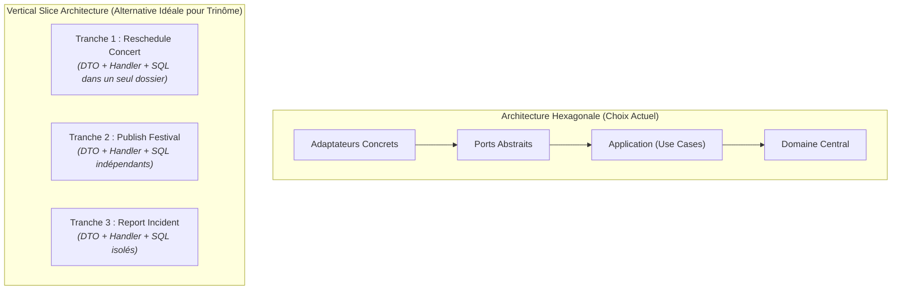

# Rétrospective, Analyse Critique & Guide des Bonnes Pratiques — FestiPlan

**Projet :** FestiPlan — Gestion de Festival de Musique  
**Module :** Architecture Hexagonale & DDD — Ynov B3  
**Document :** Rétrospective d'ingénierie, analyse comparative des architectures et Blueprint pour futurs projets  
**Auteurs :** Équipe FestiPlan (Hugo Cabanes & trinôme)

---

## 1. Introduction

Ce document dresse un bilan honnête, technique et sans concession du projet FestiPlan.  
L'objectif est double :
1. **Évaluer objectivement la qualité du projet** dans son état actuel (forces, faiblesses, dettes techniques résiduelles).
2. **Fournir un guide méthodologique ("Blueprint")** pour que la prochaine fois qu'un projet informatique est initié en équipe, vous disposiez immédiatement d'une base saine, industrialisée et sans friction.

---

## 2. Que penser du projet FestiPlan actuellement ? (Bilan Objectif)

### Les Points Forts Remarquables
* **Cœur de domaine 100% pur (DDD respecté) :** Les entités (`Concert`, `Incident`) et objets-valeurs (`TimeSlot`) sont totalement agnostiques de tout framework. Zéro dépendance à FastAPI, Pydantic ou SQLAlchemy dans `app/domain/`.
* **Inversion de dépendance exemplaire (Ports & Adapters) :** L'application communique exclusivement avec des contrats abstraits (`typing.Protocol`), ce qui permet d'interchanger instantanément la persistance SQLite réelle avec des dépôts en mémoire.
* **Pyramide de tests ultra-rapide (83 tests en ~1.7s) :**
  * 28 tests unitaires de domaine purs (exécutés en quelques millisecondes, sans I/O).
  * 25 tests unitaires applicatifs validant l'orchestration des cas d'usage.
  * 20 tests d'intégration réelle avec FastAPI `TestClient` et base relationnelle.
  * 10 tests automatisés de cybersécurité (Injections SQL, XSS, headers OWASP, anti-fuite d'erreurs).
* **Résolution éprouvée des 3 défauts initiaux :**
  * *Défaut 1 (Conflits de scène et d'artiste) :* Impossible de créer un chevauchement.
  * *Défaut 2 (Panne de notification) :* La persistance en base n'est plus compromise par une défaillance de messagerie réseau.
  * *Défaut 3 (Verrouillage du planning) :* Toute altération ordinaire d'un festival publié est formellement bloquée.

### Les Faiblesses et Dettes Techniques Résiduelles
1. **Absence de gestion de la concurrence (Race Conditions) :**
   Si deux organisateurs cliquent exactement au même millième de seconde pour programmer deux concerts différents sur la même scène, deux requêtes HTTP concurrentes pourraient passer les vérifications avant que le commit ne soit finalisé. Il manque un mécanisme de verrouillage optimiste (*Optimistic Concurrency Control* avec un numéro de version sur l'agrégat) ou pessimiste au niveau SQL.
2. **Initialisation de la base par `create_all()` :**
   L'application utilise encore `Base.metadata.create_all(bind=engine)` au démarrage. En production, cela empêche les migrations de schéma incrémentales (ajouter ou renommer une colonne sans supprimer la base).
3. **Absence d'authentification et de contrôle d'accès (RBAC) :**
   Tous les endpoints sont actuellement publics. N'importe quel client HTTP peut publier le festival, déplacer des concerts ou déclarer des incidents.
4. **Effets secondaires synchrones :**
   Même si l'échec de notification est découplé et n'annule plus la transaction, l'appel à l'adaptateur email reste synchrone au fil d'exécution de la requête HTTP. Si le serveur SMTP met 3 secondes à répondre, le client HTTP attend 3 secondes.

---

## 3. Le projet aurait-il pu être mieux conçu ?

| Axe d'Amélioration | Conception Actuelle | Conception Supérieure ("State of the Art") | Bénéfice direct |
| :--- | :--- | :--- | :--- |
| **Gestion des Événements** | Notification appelée directement dans le Use Case (`notification_sender.notify(...)`). | **Outbox Pattern** : L'événement `ConcertRescheduledEvent` est persisté dans une table `outbox` dans la même transaction SQL que le concert, puis un worker d'arrière-plan dépile les notifications. | Tolérance absolue aux pannes : zéro perte de message, temps de réponse HTTP quasi-instantané (< 15ms). |
| **Gestion de la Concurrence** | Vérification en lecture puis écriture (`list_for_festival` puis `save`). | **Optimistic Locking** : Chaque concert ou festival porte un champ `version: int`. Le `UPDATE` SQL vérifie `WHERE id = :id AND version = :v`. | Élimination mathématique de toute possibilité de conflit horaire sous forte charge concurrente. |
| **Migrations BDD** | `create_all()` automatique au démarrage. | **Alembic** avec fichiers de migrations versionnés dans Git (`alembic upgrade head`). | Capacité à faire évoluer le schéma de base de données en production sans perte de données. |
| **Command / Query Responsibility** | Les Use Cases mélangent lecture et écriture (`get_schedule_info` + mise à jour). | **CQRS léger** : Séparer strictement les modèles de lecture (requêtes directes ultra-rapides sans charger d'entités complètes) des modèles d'écriture (commandes transactionnelles). | Code de lecture plus simple et performances de consultation décuplées. |

---

## 4. Une autre architecture aurait-elle été plus adaptée ?

Dans ce projet, l'**Architecture Hexagonale (Ports & Adapters)** était le choix imposé par le module, et elle a parfaitement rempli son rôle pédagogique en forçant la séparation du domaine et de l'infrastructure.

Néanmoins, en entreprise, d'autres architectures auraient présenté des avantages majeurs :



### 1. Vertical Slice Architecture (Architecture en Tranches Verticales) — *La plus adaptée au travail d'équipe*
* **Principe :** Au lieu de découper horizontalement en couches techniques (`domain`, `application`, `adapters`, `repositories`), on découpe verticalement par **cas d'utilisation métier** (ex. `features/scheduling/reschedule_concert/`). Chaque tranche contient son DTO, son handler de commande et sa requête SQL.
* **Pourquoi elle aurait été supérieure ici ?**
  * **Zéro conflit Git :** Le Développeur 1 travaille dans `features/scheduling/`, le Développeur 2 dans `features/logistics/`, le Développeur 3 dans `features/operations/`. Aucun développeur ne touche aux mêmes fichiers de repositories ou de routeurs.
  * **Moins de cérémonie d'abstractions :** Pas besoin de créer une interface Protocol + une classe d'implémentation pour une simple lecture.

### 2. Modular Monolith (Monolithe Modulaire)
* **Principe :** Structurer l'application comme 3 modules autonomes (`scheduling_module`, `logistics_module`, `operations_module`) avec chacun son propre hexagone et sa propre base ou tables isolées, communicant entre eux uniquement par des événements de domaine asynchrones.
* **Intérêt :** Prépare une migration ultérieure vers des microservices sans en subir la complexité réseau au départ.

### En conclusion sur l'architecture :
L'Architecture Hexagonale est **excellente pour le cœur métier complexe** (notamment le calcul des conflits d'horaires et de scènes). Cependant, la combiner avec une organisation orientée **Tranches Verticales par Pôle** aurait évité la dispersion des fichiers et facilité la répartition du travail d'équipe.

---

## 5. Ce qu'il faudrait pour un rendu "Production Ready" (Professionnel & Facile)

Pour transformer cette application d'école en produit logiciel de niveau professionnel :

### 1. Authentification & Sécurité Avancée (RBAC)
* Authentification via **JWT / OAuth2** (intégration avec Keycloak ou Auth0).
* Gestion fine des rôles :
  * `ROLE_ADMIN` : création de festivals et publication.
  * `ROLE_REGISSEUR` : reprogrammation d'urgence de concerts et déclaration d'incidents.
  * `ROLE_PUBLIC` : consultation du planning en lecture seule.
* **Rate Limiting granulaire** (ex. `slowapi` ou Redis token bucket) limitant à 100 requêtes/minute par IP.

### 2. Expérience Utilisateur (UI / Visualiseur de Festival)
* Swagger UI est un outil de test pour développeurs, pas pour des organisateurs.
* **Ajout d'un tableau de bord visuel :** Une page web interactive simple affichant le planning sous forme de **Timeline / Grille horaire multi-scènes** (comme un programme réel du Hellfest). Les organisateurs pourraient glisser-déposer un concert pour le reprogrammer, et les scènes en conflit clignoteraient en rouge.

### 3. Outillage Développeur (Developer Experience - DX)
* Un fichier `Makefile` ou `Taskfile` permettant à n'importe quel développeur fraîchement arrivé de taper :
  ```bash
  make install   # Crée venv, installe dépendances, configure pre-commit
  make seed      # Peuple la base de démonstration
  make test      # Lance toute la suite de 83 tests
  make run       # Démarre l'API en mode rechargement
  ```
* Conteneurisation **Docker & Docker Compose** : éliminer définitivement les différences Windows / macOS / Linux et les soucis de chemins `.venv`.

---

## 6. Le "Blueprint" : Guide du Démarrage Parfait pour un Futur Projet

Pour votre prochain projet informatique en équipe, **voici le protocole exact à appliquer dès le premier jour** pour travailler sereinement et efficacement.

---

### Phase 1 : Le "Day 1 Pipeline" (Avant d'écrire la moindre ligne de code métier)

Ne commencez **jamais** par coder des fonctionnalités. Réservez la première demi-journée à ces 5 étapes :

#### 1. Figer les Conventions de Commits (Convention de Dev 2 avec Gitmoji)
Adoptez dès le début le format standardisé :
```text
<gitmoji> <type>(<pôle>): <description>
```
* Exemples :
  * `✨ feat(planification): ajouter le value object TimeSlot`
  * `🐛 fix(operations): capturer l'échec de notification pour éviter l'erreur 500`
  * `✅ test(securite): ajouter les tests de non-injection SQL`
  * `📝 docs(architecture): ajouter le diagramme de séquence`

#### 2. Workflow Git & Protection des Branches
* Branche `main` : code de production, **protégée** (interdiction de push direct).
* Branche `staging` ou `develop` : intégration commune.
* Branches de fonctionnalités : `feat/<pole>-<nom-fonctionnalite>`.
* **Règle absolue :** Tout merge passe par une Pull Request avec obligation que la suite de tests soit 100% verte.

#### 3. Automatisation CI GitHub Actions (`.github/workflows/ci.yml`)
Dès le premier commit, configurez un workflow qui exécute automatiquement sur chaque push et PR :
1. Le formatage et linter (`ruff` ou `black` + `flake8`).
2. Le typage statique (`mypy`).
3. L'exécution complète des tests (`pytest`).

#### 4. Pre-commit Hooks locaux
Installez `pre-commit` pour bloquer les commits mal formatés ou contenant des mots de passe/tokens secrets avant même qu'ils n'atteignent Git.

#### 5. Docker Compose unifié
Un simple `docker-compose.yml` avec l'API et une base de données évite que l'un utilise Python 3.10 sur Mac et l'autre Python 3.13 sur Windows avec des configurations divergentes.

---

### Phase 2 : Matrice des Rôles & Contrats d'Interfaces (Dès le Day 2)

Quand 3 développeurs travaillent en parallèle :
1. **Définir les contrats d'interfaces (Ports) en commun le premier jour :**
   Avant que Dev 1 ne code les concerts et Dev 2 les artistes, écrivez ensemble les signatures des méthodes dans `app/domain/ports/`.
2. **Utiliser des doubles en mémoire (`InMemoryRepository`) :**
   Grâce aux ports, Dev 1 peut tester l'intégralité de ses use cases avec son `InMemoryRepository` sans attendre que Dev 2 ait terminé ses tables SQL.
3. **Prévoir une branche de secours (Plan B) :**
   Comme nous l'avons fait aujourd'hui, si un membre prend du retard, isoler le travail sur une branche dédiée permet de sécuriser la livraison finale sans casser le travail d'équipe.

---

### Synthèse pour les futurs projets

```text
SUCCÈS D'UN PROJET D'INGÉNIERIE =
   Architecture Hexagonale ou Vertical Slices (Code robuste et découplé)
 + Conventions strictes dès le Day 1 (Gitmoji, Linter, CI automatisée)
 + Tests Pyramide rapides (Unitaires purs > Use Cases > Intégration)
 + Sécurité en profondeur dès la conception (OWASP dès l'entrée DTO)
 + Outillage simple (Makefile / Docker pour onboarding en 2 minutes)
```
