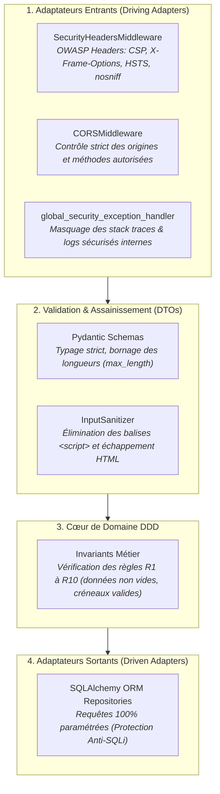

# Dossier d'Ingénierie Cybersécurité & Hardening — FestiPlan

**Projet :** FestiPlan — API de Gestion de Festival  
**Contexte :** Renforcement de la sécurité applicative (Sécurité en Profondeur dans l'Architecture Hexagonale)  
**Branche Git :** `feat/security-hardening`  
**Référence des menaces :** OWASP Top 10 API Security Risks

---

## 1. Pourquoi la Cybersécurité dans FestiPlan ?

Bien que le sujet initial se focalise sur l'architecture hexagonale et DDD, **une application d'entreprise ne peut pas dissocier qualité architecturale et sécurité**.

Dans l'état initial (legacy), plusieurs faiblesses techniques laissaient entrevoir des risques majeurs :
1. **Absence totale d'en-têtes HTTP de sécurité :** Vulnérabilité au Clickjacking (`X-Frame-Options` absent) et au MIME-type sniffing (`X-Content-Type-Options` absent).
2. **Risque de Stored XSS (Cross-Site Scripting) :** Aucune neutralisation des balises `` ou ``.
* **Remédiation Hexagonale :**
  * Création du composant [`InputSanitizer`](file:///c:/Users/hugoc/Ynov/Year3/ArchitectureHexagonale/festiplan/festiplan/app/adapters/primary/security/sanitizer.py).
  * Intégration via des `field_validator` Pydantic sur les schémas d'entrée ([`app/schemas.py`](file:///c:/Users/hugoc/Ynov/Year3/ArchitectureHexagonale/festiplan/festiplan/app/schemas.py)).
  * Les balises `<script>` sont automatiquement éradiquées et les caractères spéciaux (`<`, `>`, `"`, `'`, `&`) sont convertis en entités HTML inoffensives (`&lt;`, `&gt;`).
* **Preuve par les tests :** L'enregistrement d'une description avec payload malveillant conserve le texte légitime mais neutralise toute balise exécutable.

---

### 3.3 Prévention des Fuites d'Informations (OWASP A05 — Information Disclosure)
* **Menace :** Lors d'une panne imprévue (panne SQLite, erreur réseau, bug inattendu), FastAPI et Starlette peuvent renvoyer la stack trace brute au client HTTP, révélant les chemins de disques locaux (`C:\Users\hugoc\...`), les noms de tables et le schéma interne.
* **Remédiation Hexagonale :**
  * Création du gestionnaire [`global_security_exception_handler`](file:///c:/Users/hugoc/Ynov/Year3/ArchitectureHexagonale/festiplan/festiplan/app/adapters/primary/security/error_handler.py).
  * Les erreurs HTTP prévues (400, 404, 422) sont préservées pour les retours métier.
  * Toute exception inattendue est captée, logguée de manière confidentielle côté serveur avec son contexte complet, et le client reçoit une réponse générique **HTTP 500** ne contenant aucun détail sensible.
* **Preuve par les tests :** Un crash serveur provoquant une fuite d'informations simulée renvoie une réponse JSON 500 anonymisée sans aucune trace de `C:\Users` ou de structure de base.

---

### 3.4 En-têtes HTTP de Sécurité (OWASP Security Headers)
* **Menace :** Clickjacking, écoute de trafic et attaques MIME Sniffing.
* **Remédiation Hexagonale :**
  * Le middleware [`SecurityHeadersMiddleware`](file:///c:/Users/hugoc/Ynov/Year3/ArchitectureHexagonale/festiplan/festiplan/app/adapters/primary/security/security_headers.py) injecte sur **toutes les réponses HTTP** :
    * `X-Content-Type-Options: nosniff`
    * `X-Frame-Options: DENY`
    * `X-XSS-Protection: 1; mode=block`
    * `Referrer-Policy: strict-origin-when-cross-origin`
    * `Permissions-Policy: geolocation=(), microphone=(), camera=()`
    * `Content-Security-Policy: default-src 'self'; frame-ancestors 'none'; ...` (configuré pour autoriser l'affichage propre de Swagger UI tout en protégeant l'application).
* **Preuve par les tests :** Vérification systématique de la présence et de la conformité des en-têtes sur les endpoints de l'API.

---

### 3.5 Protection Anti-DoS par Dépassement de Capacité
* **Menace :** Saturation de la mémoire ou du disque par injection de descriptions textuelles de plusieurs dizaines de mégaoctets.
* **Remédiation :**
  * Bornage strict `max_length=2000` sur les descriptions d'incidents et `max_length=120` sur les noms et villes.
* **Preuve par les tests :** Rejet immédiat avec code **HTTP 422** dès qu'une charge excessive est détectée.

---

## 4. Bilan de la Suite de Tests de Sécurité

La suite dédiée [`tests/security/test_security_hardening.py`](file:///c:/Users/hugoc/Ynov/Year3/ArchitectureHexagonale/festiplan/festiplan/tests/security/test_security_hardening.py) comprend **10 tests automatisés** :

| # | Test | Objectif de sécurité | Résultat |
| :---: | :--- | :--- | :---: |
| 1 | `test_security_headers_present_on_endpoints` | Présence des en-têtes OWASP (`nosniff`, `DENY`, CSP). | **PASSED** |
| 2 | `test_sqli_in_query_parameters_fails_safe[1 OR 1=1]` | Typage strict anti-SQLi dans les query params. | **PASSED** |
| 3 | `test_sqli_in_query_parameters_fails_safe[1' OR '1'='1]` | Typage strict anti-SQLi dans les query params. | **PASSED** |
| 4 | `test_sqli_in_query_parameters_fails_safe[DROP TABLE]` | Typage strict anti-SQLi dans les query params. | **PASSED** |
| 5 | `test_sqli_in_query_parameters_fails_safe[UNION SELECT]` | Typage strict anti-SQLi dans les query params. | **PASSED** |
| 6 | `test_sqli_payload_in_text_body_is_safely_parameterized` | Paramétrage sécurisé des champs textuels SQL. | **PASSED** |
| 7 | `test_input_sanitizer_unit` | Test unitaire de neutralisation des balises HTML et scripts. | **PASSED** |
| 8 | `test_xss_injection_in_incident_description_is_sanitized` | Élimination des scripts XSS dans les descriptions d'incidents. | **PASSED** |
| 9 | `test_oversized_payload_rejected` | Rejet HTTP 422 des charges surdimensionnées (Anti-DoS). | **PASSED** |
| 10 | `test_unhandled_exception_does_not_leak_system_paths` | Masquage des chemins système et stack traces lors d'un crash 500. | **PASSED** |

**Total général de la suite FestiPlan :** **83 tests automatisés**, tous réussis en **1.77 seconde**.
