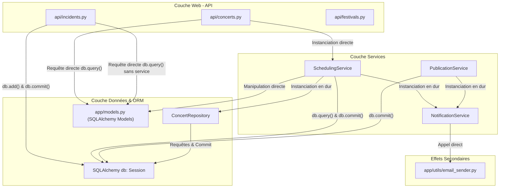

# Livrable Intermédiaire — Étape 1 : Diagnostic de l'Architecture Initiale (Legacy)

**Projet :** FestiPlan — Gestion d'un festival metal fictif (*Hellforge Open Air*)  
**Auteur :** Hugo Cabanes (Développeur 1 — Planning & Scheduling)  
**Contexte :** Module Architecture Hexagonale & DDD — Ynov B3  
**Référence du sujet :** Consignes Étape 1 (p. 7 du sujet de synthèse)

---

## 1. Responsabilités des grandes parties du code initial

L'application initiale suit une organisation apparemment en couches, mais sans étanchéité ni séparation nette des responsabilités :

| Dossier / Composant | Rôle théorique | Responsabilités réelles observées (Anomalies) |
| :--- | :--- | :--- |
| [app/api/](file:///c:/Users/hugoc/Ynov/Year3/ArchitectureHexagonale/festiplan/festiplan/app/api) (Routes HTTP) | Réception des requêtes HTTP, validation d'entrée et formatage des réponses. | **Mélange des genres :** en plus du routage, certains contrôleurs effectuent des requêtes SQL directes (`db.query(...)`), vérifient des règles métier (ex. `end_time <= start_time`), et transforment manuellement des chaînes CSV en listes d'équipements (`out(a)`). |
| [app/services/](file:///c:/Users/hugoc/Ynov/Year3/ArchitectureHexagonale/festiplan/festiplan/app/services) (Services) | Orchestration de la logique applicative. | **Couplage fort et dispersion :** les services reçoivent la session SQLAlchemy (`db: Session`), instancient eux-mêmes en dur leurs dépendances techniques (`ConcertRepository(db)`, `NotificationService()`), déclenchent des `commit()` en base et appellent des effets secondaires (email). |
| [app/repositories/](file:///c:/Users/hugoc/Ynov/Year3/ArchitectureHexagonale/festiplan/festiplan/app/repositories) (Dépôts) | Abstraction de l'accès aux données. | **Responsabilité transactionnelle mal placée :** les méthodes `create()` font un `self.db.commit()` et `self.db.refresh()`, privant la couche supérieure de la gestion transactionnelle globale (impossible de faire un rollback multi-opérations). |
| [app/models.py](file:///c:/Users/hugoc/Ynov/Year3/ArchitectureHexagonale/festiplan/festiplan/app/models.py) (Modèles ORM) | Représentation des tables relationnelles. | **Confusion Domaine / BDD :** ces classes SQLAlchemy servent à la fois de schéma de base de données relationnelle, d'objets métier manipulés par les services, et de structures de données passées aux réponses HTTP. |
| [app/schemas.py](file:///c:/Users/hugoc/Ynov/Year3/ArchitectureHexagonale/festiplan/festiplan/app/schemas.py) (Schémas Pydantic) | DTOs de validation d'entrée/sortie API. | Contiennent des validations de format (longueur de chaînes, champs requis), mais certaines règles métier y sont déléguées au lieu d'appartenir au domaine. |
| [app/utils/](file:///c:/Users/hugoc/Ynov/Year3/ArchitectureHexagonale/festiplan/festiplan/app/utils) (Utilitaires) | Fonctions transverses. | `email_sender.py` simule l'envoi d'emails en dépendant de `settings`, et `date_helpers.py` contient une fonction `overlaps` isolée hors de tout objet métier. |

---

## 2. Graphe des dépendances et couplage technique (Schéma)

Dans l'état initial, la règle d'inversion des dépendances est violée à tous les niveaux. Toutes les couches convergent vers SQLAlchemy et les détails techniques d'infrastructure :



---

## 3. Dispersion des règles métier

L'analyse du code montre que les 10 règles métier identifiées dans le sujet (**R1 à R10**) sont éparpillées sans cohérence :

1. **Règles portées dans les contrôleurs HTTP :**
   * Dans [api/concerts.py:L36](file:///c:/Users/hugoc/Ynov/Year3/ArchitectureHexagonale/festiplan/festiplan/app/api/concerts.py#L36) : vérification `payload.end_time <= payload.start_time` (R1).
   * Dans [api/incidents.py:L11](file:///c:/Users/hugoc/Ynov/Year3/ArchitectureHexagonale/festiplan/festiplan/app/api/incidents.py#L11) : vérification de l'existence du concert avant déclaration d'un incident (R10).
   * *Conséquence :* Si un cas d'usage était déclenché depuis une CLI, un worker ou un script de seed, ces règles ne seraient pas exécutées.
2. **Règles portées dans les services :**
   * Dans [services/scheduling_service.py:L26-L42](file:///c:/Users/hugoc/Ynov/Year3/ArchitectureHexagonale/festiplan/festiplan/app/services/scheduling_service.py#L26-L42) : vérification de l'appartenance de la scène au festival (R4), des dates du festival (R6), des conflits de créneaux (R2/R3) et des équipements (R5).
3. **Règles totalement absentes aux endroits critiques (Les Défauts) :**
   * Dans `reschedule_concert` ([services/scheduling_service.py:L50](file:///c:/Users/hugoc/Ynov/Year3/ArchitectureHexagonale/festiplan/festiplan/app/services/scheduling_service.py#L50)) : **aucune** des règles R2, R3, R5, R6 et R7 n'est vérifiée lors du déplacement d'un concert ! Le concert est déplacé en base sans aucun contrôle de scène occupée ou d'artiste déjà engagé.
   * Dans `PublicationService.publish` ([services/publication_service.py:L12](file:///c:/Users/hugoc/Ynov/Year3/ArchitectureHexagonale/festiplan/festiplan/app/services/publication_service.py#L12)) : la règle **R8** (planning sans conflit avant publication) n'est pas vérifiée.

---

## 4. Dépendances directes à FastAPI et SQLAlchemy

Le cœur de l'application est doublement prisonnier de ses choix technologiques :

1. **Intrusion omniprésente de SQLAlchemy :**
   * Toutes les méthodes des services attendent en paramètre `db: Session`.
   * Les objets manipulés par la logique métier sont des instances directes de `Base` SQLAlchemy (`app.models.Concert`, `app.models.Festival`), dotées de mécanismes d'instrumentation et de sessions actives (`dirty`, `flush`, `refresh`).
   * **Conséquence :** Aucun calcul métier ne peut s'effectuer sans charger SQLAlchemy en mémoire et simuler une base de données.
2. **Intrusion du web (FastAPI / HTTP) :**
   * Les erreurs métier sont souvent traduites directement en `HTTPException` dans le flux d'exécution, au lieu de lever des exceptions métier pures et agnostiques du protocole web.

---

## 5. Problèmes de testabilité et risques d'incohérence

### A. Problèmes de testabilité
* **Impossibilité d'écrire des tests unitaires isolés :** Comme `SchedulingService` instancie lui-même `ConcertRepository(db)` et `NotificationService()` dans son `__init__`, il est impossible d'injecter des mocks ou des stubs sans utiliser des patchs complexes (monkeypatching) sur les modules Python.
* **Obligation d'avoir une BDD pour le moindre test :** Pour tester si deux créneaux se chevauchent, le code initial nécessite de monter une base SQLite, de créer les tables et d'insérer des enregistrements. Résultat : une suite de tests lente et couplée à l'I/O.

### B. Risques majeurs d'incohérence (Les Défauts du sujet)
1. **Incohérence des données du planning (Défaut 1) :**
   Un utilisateur peut déplacer un concert sur le créneau d'un autre concert sur la même scène : l'API l'accepte et produit un planning corrompu.
2. **Incohérence transactionnelle et effets secondaires (Défaut 2) :**
   Dans `reschedule_concert` et `publish`, le code effectue :
   ```python
   self.db.commit()          # Données persistées de manière irréversible
   self.notifications.notify(...) # Appel réseau / externe
   ```
   Si l'envoi de notification échoue (ex: panne SMTP ou `fail_notifications=True`), une exception est levée. L'API renvoie une erreur **HTTP 500**, laissant croire au client que sa requête a échoué, alors que la modification a **déjà été persistée** en base.
3. **Absence de protection du cycle de vie (Défaut 3) :**
   Le statut `status="published"` n'est qu'une chaîne de caractères sans garde-fou. Un concert peut être reprogrammé ou annulé arbitrairement après publication officielle du festival sans procédure d'urgence.

---

## 6. Exemples concrets de responsabilités mal placées

### Exemple n°1 : Bypass complet de la couche service dans [app/api/incidents.py](file:///c:/Users/hugoc/Ynov/Year3/ArchitectureHexagonale/festiplan/festiplan/app/api/incidents.py#L9-L16)
```python
@router.post("", response_model=IncidentRead, status_code=201)
def create_incident(payload: IncidentCreate, db: Session = Depends(get_db)):
    # ❌ Requête SQL brute directement dans le contrôleur HTTP
    if db.query(Concert).filter(Concert.id == payload.concert_id).first() is None: 
        raise HTTPException(status_code=404, detail="Concert introuvable")
    
    # ❌ Création et persistance directe sans règle métier ni cas d'usage
    row = Incident(concert_id=payload.concert_id,
                   description=payload.description,
                   occurred_at=payload.occurred_at)
    db.add(row); db.commit(); db.refresh(row)
    return row
```
*Le contrôleur HTTP s'occupe de la persistance, de la validation d'existence et de la transaction SQL sans aucune couche applicative.*

---

### Exemple n°2 : Instanciation rigide dans [app/services/scheduling_service.py](file:///c:/Users/hugoc/Ynov/Year3/ArchitectureHexagonale/festiplan/festiplan/app/services/scheduling_service.py#L8-L9)
```python
class SchedulingService:
    def __init__(self, db: Session): 
        self.db = db
        # ❌ Viol de l'inversion de dépendance : instanciation directe des classes concrètes
        self.repo = ConcertRepository(db)
        self.notifications = NotificationService()
```
*Le service applicatif est incapable de fonctionner avec un autre moyen de notification (SMS, webhook) ou un autre système de stockage (mémoire, MongoDB) sans réécrire sa classe.*

---

### Exemple n°3 : Bricolage du format des données dans [app/api/artists.py](file:///c:/Users/hugoc/Ynov/Year3/ArchitectureHexagonale/festiplan/festiplan/app/api/artists.py#L9-L15)
```python
def out(a):
    return {
        "id": a.id,
        "name": a.name,
        "genre": a.genre,
        # ❌ Le contrôleur fait du parsing de chaîne CSV pour combler un défaut du modèle
        "required_equipment": [x for x in a.required_equipment.split(",") if x]
    }
```
*Le contrôleur HTTP doit compenser le fait que les équipements sont stockés sous forme de texte brut séparé par des virgules dans l'ORM.*

---

## 7. Conclusion du diagnostic & Cible visée

L'application legacy souffre d'un **couplage direct à l'infrastructure** et d'une **absence de Domaine métier autonome**.

La cible hexagonale mise en place :
1. **Domaine pur :** Objets-valeurs (`TimeSlot`), entités avec invariants (`Concert.check_conflict_with`) et exceptions de domaine explicites, testables en mémoire en quelques millisecondes.
2. **Ports abstraits :** `IConcertRepository`, `IFestivalQueryPort`, `INotificationSenderPort`.
3. **Cas d'usage applicatifs :** `RescheduleConcertUseCase` qui prend en charge les validations métier avant de déléguer la persistance et isole les effets de bord (notifications).
4. **Adaptateurs interchangeables :** `ConcertSqlRepository` et `InMemoryConcertRepository`.
