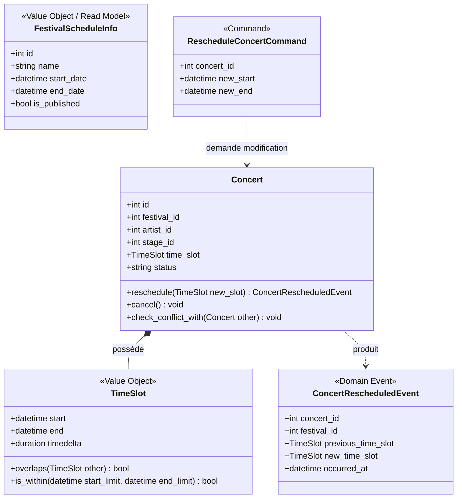

# Livrable Intermédiaire — Étape 2 : Modélisation Métier DDD (Domain-Driven Design)

**Projet :** FestiPlan — Gestion d'un festival metal fictif (*Hellforge Open Air*)  
**Auteur :** Hugo Cabanes (Développeur 1 — Planning & Scheduling)  
**Contexte :** Module Architecture Hexagonale & DDD — Ynov B3  
**Référence du sujet :** Consignes Étape 2 (p. 7-8 du sujet de synthèse)

---

## 1. Vue d'ensemble du Modèle Métier DDD

Dans l'architecture hexagonale, le **Domaine** constitue le cœur pur de l'application : il ne dépend ni d'une base de données relationnelle (SQLAlchemy), ni d'un protocole réseau (HTTP / FastAPI).

Pour structurer ce domaine et protéger nos règles métier, nous appliquons les concepts clés de **Domain-Driven Design (DDD)** :
* **Entités :** objets définis par leur identité propre et leur cycle de vie.
* **Objets-Valeurs (Value Objects) :** notions immuables définies par leurs attributs, auto-validées à la création.
* **Invariants :** règles de cohérence garanties à chaque instant.
* **Agrégats :** grappes d'objets délimitant les frontières de consistance transactionnelle.
* **Événements de Domaine :** faits métier accomplis permettant le découplage des effets secondaires.

---

## 2. Modélisation Conceptuelle du Domaine (Diagramme Mermaid)



---

## 3. Justification des Entités vs Objets-Valeurs

### 3.1 Les Entités (Identité & Cycle de Vie)

Une entité possède un identifiant unique qui persiste même si l'ensemble de ses attributs change. Deux entités ayant exactement les mêmes valeurs restent distinctes si leurs identifiants diffèrent.

| Entité | Identité | Justification métier |
| :--- | :--- | :--- |
| **`Concert`** ([app/domain/models/concert.py](file:///c:/Users/hugoc/Ynov/Year3/ArchitectureHexagonale/festiplan/festiplan/app/domain/models/concert.py)) | `id: int \| None` | Deux concerts peuvent avoir lieu sur le même festival, avec le même groupe, à deux dates différentes (ex. *Iron Vow* jouant un set acoustique puis un set électrique). Le concert possède son propre cycle de vie (`scheduled` -> `cancelled`). |
| **`Festival`** | `id: int` | Représente l'événement global (ex: *Hellforge Open Air 2027*). Son nom ou ses dates peuvent être réajustés sans changer l'identité de l'événement. |
| **`Artist`** | `id: int` | Représente le groupe musical invité. |
| **`Stage`** | `id: int` | Représente l'espace physique (scène *Mainstage*, *Warzone*). |
| **`Incident`** | `id: int` | Signalement horodaté rattaché à un concert. |

---

### 3.2 Les Objets-Valeurs / Value Objects (Immuabilité & Égalité structurelle)

Un objet-valeur n'a pas d'identité propre. Il est défini uniquement par les valeurs qu'il contient. Deux objets-valeurs possédant les mêmes attributs sont strictement interchangeables. Ils sont **immuables** (`frozen=True`) et garantissent leur propre validité dès leur instanciation.

#### 1. L'Objet-Valeur `TimeSlot` ([app/domain/value_objects/time_slot.py](file:///c:/Users/hugoc/Ynov/Year3/ArchitectureHexagonale/festiplan/festiplan/app/domain/value_objects/time_slot.py))
* **Attributs :** `start: datetime`, `end: datetime`.
* **Pourquoi est-ce un Value Object ?** Un créneau *18h00 - 19h00* n'a pas d'ID en base. Si deux concerts ont lieu de 18h à 19h, ils partagent conceptuellement la même valeur temporelle.
* **Richesse comportementale :**
  * `duration` : calcul dynamique de la durée.
  * `overlaps(other)` : calcul pur d'intersection temporelle (`start_a < end_b and start_b < end_a`).
  * `is_within(start_limit, end_limit)` : vérification d'inclusion dans une période.

#### 2. L'Objet-Valeur `FestivalScheduleInfo` ([app/domain/ports/repositories/festival_repository_port.py](file:///c:/Users/hugoc/Ynov/Year3/ArchitectureHexagonale/festiplan/festiplan/app/domain/ports/repositories/festival_repository_port.py))
* Modèle de lecture immuable transmettant les bornes temporelles et le statut `is_published` du festival au cas d'usage sans exposer l'ORM.

---

## 4. Définition et Localisation des Invariants

Un **invariant** est une règle de cohérence qui doit être vraie à tout instant pour qu'un objet métier soit dans un état valide.

DDD impose de placer chaque invariant **au plus près de la structure qui en a la responsabilité** :

| Invariant Métier | Règle Sujet | Localisation dans le code | Justification du choix |
| :--- | :---: | :--- | :--- |
| **Heure de fin strictement postérieure à l'heure de début** | **R1** | [app/domain/value_objects/time_slot.py](file:///c:/Users/hugoc/Ynov/Year3/ArchitectureHexagonale/festiplan/festiplan/app/domain/value_objects/time_slot.py) (`__post_init__`) | **Invariant intrinsèque :** Un créneau dont la fin précède ou égale le début n'a aucun sens physique. En le plaçant dans le `TimeSlot`, il est techniquement impossible qu'un concert existe dans l'application avec des dates incohérentes. |
| **Interdiction de déplacer un concert annulé** | Interne | [app/domain/models/concert.py](file:///c:/Users/hugoc/Ynov/Year3/ArchitectureHexagonale/festiplan/festiplan/app/domain/models/concert.py) (`reschedule()`) | **Invariant d'Entité :** Une entité `Concert` est responsable de son cycle de vie. Elle refuse elle-même une mutation incompatible avec son statut. |
| **Non-chevauchement sur une même scène** | **R2** | [app/domain/models/concert.py](file:///c:/Users/hugoc/Ynov/Year3/ArchitectureHexagonale/festiplan/festiplan/app/domain/models/concert.py) (`check_conflict_with()`) | **Invariant inter-entités :** La méthode métier compare deux concerts et lève `StageOccupiedError` si les scènes coïncident et que les créneaux se recoupent. |
| **Disponibilité de l'artiste** | **R3** | [app/domain/models/concert.py](file:///c:/Users/hugoc/Ynov/Year3/ArchitectureHexagonale/festiplan/festiplan/app/domain/models/concert.py) (`check_conflict_with()`) | **Invariant inter-entités :** Lève `ArtistAlreadyBookedError` si un artiste est mobilisé sur deux scènes au même moment. |
| **Inclusion dans la période du festival** | **R6** | [app/application/use_cases/scheduling/reschedule_concert.py](file:///c:/Users/hugoc/Ynov/Year3/ArchitectureHexagonale/festiplan/festiplan/app/application/use_cases/scheduling/reschedule_concert.py) | **Invariant d'Agrégat / Cas d'usage :** Requiert la confrontation de deux agrégats (`Festival` et `Concert`). Confié au cas d'usage qui orchestre la vérification avant mutation. |
| **Verrouillage du planning publié** | **R7** | [app/application/use_cases/scheduling/reschedule_concert.py](file:///c:/Users/hugoc/Ynov/Year3/ArchitectureHexagonale/festiplan/festiplan/app/application/use_cases/scheduling/reschedule_concert.py) | **Invariant d'État :** Empêche toute altération ordinaire si le festival a atteint le statut publié. |

---

## 5. Définition des Frontières d'Agrégats (Aggregate Boundaries)

Un **agrégat** regroupe des objets métier soumis à des règles de cohérence communes. Sa **racine d'agrégat (Aggregate Root)** est le seul point d'entrée pour les modifications externes.

### Le choix de conception retenu

En DDD (recommandations de Vaughn Vernon), deux approches étaient possibles :
1. **L'agrégat géant `Festival` :** Le festival contiendrait toutes ses scènes et tous ses concerts dans une seule grappe d'objets en mémoire.  
   *Inconvénient majeur :* Performances catastrophiques et conflits de concurrence (modifier l'horaire d'un concert à 14h obligerait à charger et verrouiller l'intégralité du festival et ses 50 concerts).
2. **Des agrégats distincts référencés par identifiants (Choix retenu) :**
   * **Agrégat `Festival`** (Racine : `Festival`) : gère son identité, son lieu, ses dates globales et son cycle de publication.
   * **Agrégat `Concert`** (Racine : `Concert`) : gère son créneau horaire, son statut (programmé/annulé), et référence le festival, l'artiste et la scène par leurs identifiants (`festival_id`, `artist_id`, `stage_id`).

### Justification de la frontière
* **Performance et isolation :** Chaque concert peut être manipulé, déplacé ou annulé indépendamment sans verrouiller l'ensemble des données du festival.
* **Garantie de cohérence globale :** Le cas d'usage applicatif (`RescheduleConcertUseCase`) se charge de charger la collection des concerts du festival via `IConcertRepository.list_for_festival(...)` pour exécuter les contrôles de chevauchement (R2, R3) avant de valider la transaction.

---

## 6. Événements de Domaine (Domain Events) & Découplage

Le sujet insiste particulièrement sur la distinction de quatre concepts dans le flux de traitement :

```text
┌────────────────────────────┐
│ 1. Commande                │  Demande d'action explicite (intention)
│ RescheduleConcertCommand   │  Ex: "Déplacer le concert #1 de 14h à 15h"
└─────────────┬──────────────┘
              │
              ▼
┌────────────────────────────┐
│ 2. Cas d'Utilisation       │  Orchestration et application des invariants
│ RescheduleConcertUseCase   │  - Valide R1, R2, R3, R6, R7
└─────────────┬──────────────┘  - Persiste le nouvel état via IConcertRepository
              │
              ▼
┌────────────────────────────┐
│ 3. Événement de Domaine    │  Fait accompli immuable (passé)
│ ConcertRescheduledEvent    │  "Le concert #1 a été déplacé"
└─────────────┬──────────────┘
              │
              ▼
┌────────────────────────────┐
│ 4. Mécanisme Technique     │  Effet secondaire réactif non bloquant
│ EmailNotificationAdapter   │  Envoi d'un email de notification
└────────────────────────────┘
```

### Bénéfice immédiat (Résolution du Défaut 2)
Dans le code legacy, l'appel à la notification était directement imbriqué après le commit SQL, faisant crasher la requête en 500 en cas de défaillance réseau.  
En séparant clairement **le fait accompli** (`ConcertRescheduledEvent`) du **mécanisme technique réactif** (`INotificationSenderPort`), l'échec de la notification est traité comme un incident technique secondaire : il est consigné dans les logs sans annuler la réussite du cas d'usage, assurant une parfaite cohérence pour l'utilisateur.
