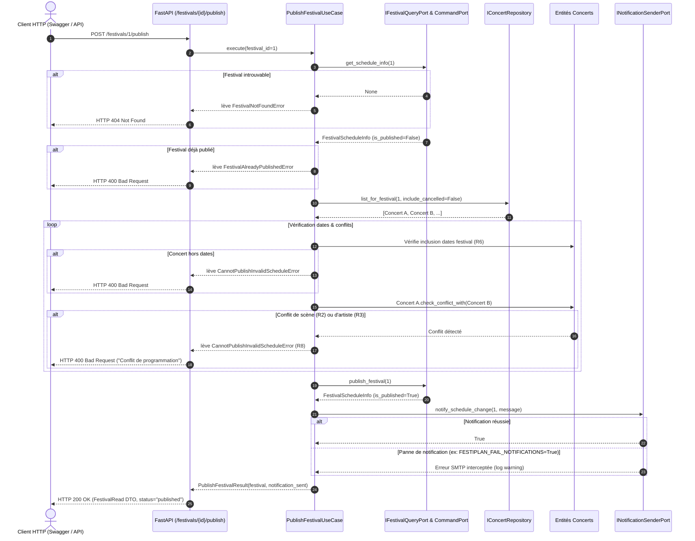

# Note d'Architecture & Choix Techniques — Pôle Opérations & Publication (Développeur 3)

**Projet :** FestiPlan — Refactorisation en Architecture Hexagonale & DDD  
**Auteur du pôle :** Développeur 3 (Cycle de vie, Publication, Incidents & Notifications)  
**Contexte :** Module Architecture Hexagonale — Ynov B3  
**Références :** Consignes des étapes 1 à 6 et livrables finaux attendus (sujet de synthèse)

---

## 1. Vue d'Ensemble & Objectifs du Pôle Développeur 3

Le pôle **Opérations & Publication** est chargé de deux responsabilités majeures :
1. **La publication du festival (Règle R8 & Défaut 2) :** Garantir qu'un planning ne peut être publié que si tous ses concerts respectent rigoureusement les contraintes métier (absence de conflit de scène, absence de conflit d'artiste, dates du festival). L'échec éventuel de la notification post-publication ne doit pas compromettre l'opération.
2. **La gestion des incidents techniques (Règle R10) :** Offrir un suivi fiable des incidents survenus pendant les concerts, avec garantie qu'un incident est toujours associé à un concert existant et comporte une description non vide.

---

## 2. Diagramme UML de Composants (Pôle Opérations)

```mermaid
graph TB
    subgraph Driving_Adapters ["Adaptateurs Entrants (Driving Adapters)"]
        API_Festivals["FastAPI Router<br><b>app/api/festivals.py</b><br><i>POST /{id}/publish</i>"]
        API_Incidents["FastAPI Router<br><b>app/api/incidents.py</b><br><i>POST, GET, PATCH /resolve</i>"]
        DTO_Schemas["Pydantic Schemas<br><b>IncidentCreate / IncidentRead</b>"]
    end

    subgraph Application_Layer ["Couche Application (Use Cases)"]
        UC_Publish["<b>PublishFestivalUseCase</b><br>Validation intégrité R8 & Publication"]
        UC_Declare["<b>DeclareIncidentUseCase</b><br>Signalement incident R10"]
        UC_Resolve["<b>ResolveIncidentUseCase</b><br>Résolution incident"]
        UC_List["<b>ListIncidentsUseCase</b><br>Consultation & filtrage"]
    end

    subgraph Domain_Core ["Cœur de Domaine DDD"]
        Entity_Incident["Entité Pure<br><b>Incident</b><br><i>Invariant: description non vide (R10)</i><br><i>resolve()</i>"]
        Events_Domain["Événements de Domaine<br><b>IncidentReportedEvent</b><br><b>IncidentResolvedEvent</b><br><b>FestivalPublishedEvent</b>"]
        Exceptions_Domain["Exceptions Métier<br><b>CannotPublishInvalidScheduleError</b><br><b>IncidentInvalidDescriptionError</b>"]
    end

    subgraph Ports_Layer ["Ports Abstraits (Interfaces / Protocols)"]
        Port_IncRepo["Port Persistance Incident<br><b>IIncidentRepository</b>"]
        Port_FestCmd["Port Commande Festival<br><b>IFestivalCommandPort</b>"]
        Port_FestQuery["Port Requête Festival<br><b>IFestivalQueryPort</b>"]
        Port_ConcertRepo["Port Persistance Concert<br><b>IConcertRepository</b>"]
        Port_Notif["Port Notification<br><b>INotificationSenderPort</b>"]
    end

    subgraph Driven_Adapters ["Adaptateurs Sortants (Driven Adapters)"]
        Adapter_IncSQL["Adaptateur SQLAlchemy<br><b>IncidentSqlRepository</b>"]
        Adapter_IncMem["Adaptateur Mémoire<br><b>InMemoryIncidentRepository</b>"]
        Adapter_FestSQL["Adaptateur SQLAlchemy Festival<br><b>FestivalSqlQueryAdapter</b>"]
        Adapter_Mail["Adaptateur Email<br><b>EmailNotificationAdapter</b>"]
    end

    %% Relations HTTP -> Use Cases
    API_Festivals --> UC_Publish
    API_Incidents --> DTO_Schemas
    API_Incidents --> UC_Declare
    API_Incidents --> UC_Resolve
    API_Incidents --> UC_List

    %% Relations Use Cases -> Domain
    UC_Publish --> Exceptions_Domain
    UC_Declare --> Entity_Incident
    UC_Resolve --> Entity_Incident

    %% Relations Use Cases -> Ports
    UC_Publish --> Port_FestQuery
    UC_Publish --> Port_FestCmd
    UC_Publish --> Port_ConcertRepo
    UC_Publish --> Port_Notif

    UC_Declare --> Port_IncRepo
    UC_Declare --> Port_ConcertRepo
    UC_Resolve --> Port_IncRepo
    UC_List --> Port_IncRepo

    %% Implémentations Ports
    Adapter_IncSQL -.->|"Implémente"| Port_IncRepo
    Adapter_IncMem -.->|"Implémente"| Port_IncRepo
    Adapter_FestSQL -.->|"Implémente"| Port_FestCmd
    Adapter_FestSQL -.->|"Implémente"| Port_FestQuery
    Adapter_Mail -.->|"Implémente"| Port_Notif
```

---

## 3. Diagramme UML de Séquence : Publication du Festival (R8 & Défaut 2)

---

## 4. Choix de Conception & Justifications

### 4.1 Entité Pure `Incident` et Invariant R10
* **Pourquoi une entité ?** Chaque incident possède une identité propre (`id`), un cycle de vie (`resolved: False -> True`) et un horodatage (`occurred_at`).
* **Protection de l'invariant R10 :** La règle R10 impose une description non vide et un rattachement à un concert existant. Le domaine protège cette règle dès l'instanciation (`__post_init__`) en levant `IncidentInvalidDescriptionError` si la chaîne est vide ou constituée d'espaces.
* **Résolution métier :** La méthode `resolve()` gère la transition d'état et émet `IncidentResolvedEvent`, tout en empêchant la ré-résolution d'un incident déjà résolu.

### 4.2 Cas d'Usage `PublishFestivalUseCase` et Règle R8
* **Problème legacy initial :** L'ancien service `PublicationService` passait aveuglément le festival à `"published"` sans analyser l'intégrité des concerts.
* **Solution DDD :** Avant toute publication, le cas d'usage convoque `IConcertRepository` et soumet chaque paire de concerts actifs à la méthode `check_conflict_with()` du domaine. Ainsi, si deux concerts se chevauchent sur une même scène ou partagent le même groupe au même moment, la publication est immédiatement rejetée avec une explication claire.

### 4.3 Résolution du Défaut 2 (Résistance aux pannes de notification)
* **Problème legacy initial :** En cas d'erreur de communication réseau lors de l'envoi du mail de publication, l'API renvoyait une erreur `500 Internal Server Error`, laissant le client croire que l'opération avait échoué alors que la base de données avait été altérée.
* **Solution Hexagonale :** L'envoi de notification est encapsulé derrière le port `INotificationSenderPort`. Tout échec d'envoi est capté et consigné en `WARNING`, sans annuler la transaction et en retournant un code **HTTP 200 OK**.

### 4.4 Ségrégation des interfaces (ISP) pour les festivals
* Au lieu de coupler le cas d'usage à un modèle SQLAlchemy monolithique, nous avons séparé les ports :
  * `IFestivalQueryPort` : pour la lecture des métadonnées du festival (`get_schedule_info`).
  * `IFestivalCommandPort` : pour l'écriture du changement d'état (`publish_festival`).

---

## 5. Stratégie de Tests du Pôle Opérations

Le pôle intègre **29 tests automatisés** répartis sur les 3 niveaux de la pyramide :

| Niveau | Fichier de test | Nombre | Rôle |
| :--- | :--- | :---: | :--- |
| **Unitaires Domaine** | `tests/unit/operations/test_incident.py` | 8 | Invariant R10, validation des descriptions, méthode `resolve()`, exceptions domaine. |
| **Unitaires Cas d'Usage** | `tests/unit/operations/test_publish_festival_use_case.py` | 7 | Validation R8 (conflits scènes/artistes/dates), refus festival déjà publié, échec notification non bloquant (Défaut 2). |
| **Unitaires Cas d'Usage** | `tests/unit/operations/test_incident_use_cases.py` | 6 | Création d'incident, résolution, listing et filtrage par concert via doubles mémoire. |
| **Intégration API & BDD** | `tests/integration/test_operations_integration.py` | 8 | Endpoints `/incidents` (POST, GET, PATCH resolve) et `/festivals/{id}/publish` de bout en bout avec SQLite. |

**Résultat global :** 100% des tests réussissent en moins de 1.7 seconde.
