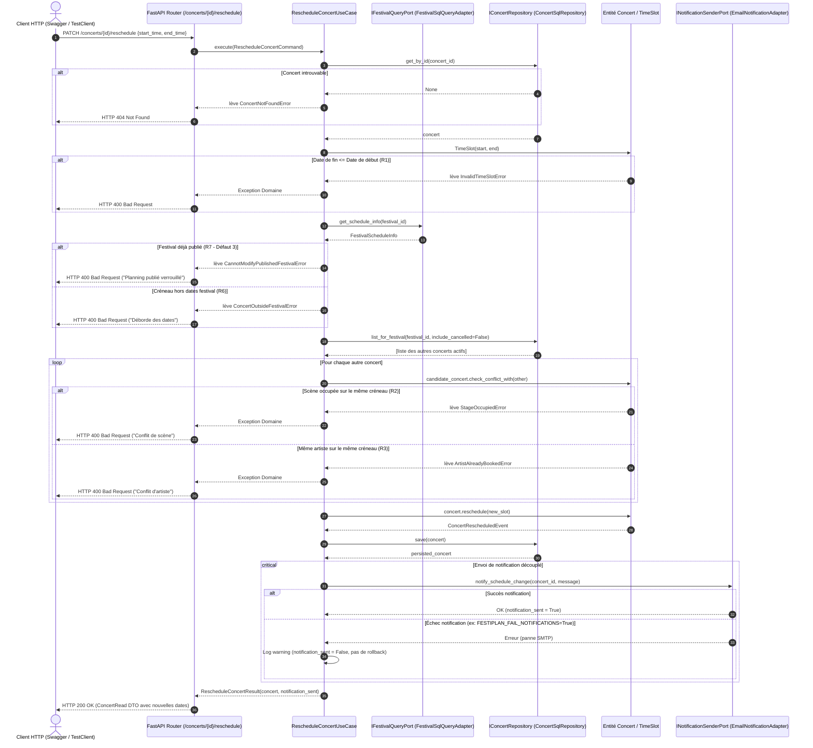

# Livrables Finaux & Documentation Technique — FestiPlan

**Projet :** FestiPlan — Refactorisation en Architecture Hexagonale & DDD  
**Auteur :** Hugo Cabanes (Développeur 1 — Planning & Scheduling)  
**Contexte :** Module Architecture Hexagonale — Ynov B3  
**Références du sujet :** Documentation technique attendue (p. 13-14 du sujet de synthèse)

---

## 1. Diagramme UML de Composants

Le diagramme suivant représente l'architecture hexagonale **réellement implémentée** dans le code.  
Il illustre la séparation stricte entre le monde extérieur (adaptateurs entrants et sortants), les cas d'usage applicatifs et le cœur de domaine, en mettant en avant les **ports** (interfaces) assurant l'inversion de dépendance.

```mermaid
graph TB
    subgraph Driving_Adapters ["Adaptateurs Entrants (Driving / Primary Adapters)"]
        API_Route["FastAPI Router<br><b>app/api/concerts.py</b>"]
        DTO_Schemas["Pydantic Schemas<br><b>ConcertCreate / ConcertReschedule</b>"]
    end

    subgraph Application_Layer ["Couche Application (Use Cases)"]
        UC_Reschedule["<b>RescheduleConcertUseCase</b><br>Orchestration du déplacement"]
        UC_Schedule["<b>ScheduleConcertUseCase</b><br>Programmation initiale"]
        UC_Cancel["<b>CancelConcertUseCase</b><br>Annulation"]
        UC_Get["<b>GetFestivalScheduleUseCase</b><br>Lecture chronologique"]
    end

    subgraph Domain_Core ["Cœur de Domaine (Domain Core)"]
        Entity_Concert["Entité Pure<br><b>Concert</b><br><i>check_conflict_with()</i><br><i>reschedule() / cancel()</i>"]
        VO_TimeSlot["Objet-Valeur<br><b>TimeSlot</b><br><i>overlaps() / is_within()</i><br><i>Invariant: end > start</i>"]
        Event_Rescheduled["Événement de Domaine<br><b>ConcertRescheduledEvent</b>"]
    end

    subgraph Ports_Layer ["Ports Abstraits (Interfaces / Protocol)"]
        Port_Repo["Port Sortant BDD<br><b>IConcertRepository</b>"]
        Port_Fest["Port Requête Festival<br><b>IFestivalQueryPort</b>"]
        Port_Notif["Port Sortant Notif<br><b>INotificationSenderPort</b>"]
    end

    subgraph Driven_Adapters ["Adaptateurs Sortants (Driven / Secondary Adapters)"]
        Repo_SQL["Adaptateur SQLAlchemy<br><b>ConcertSqlRepository</b><br><i>festiplan.db (SQLite)</i>"]
        Repo_Mem["Adaptateur Mémoire<br><b>InMemoryConcertRepository</b><br><i>(Tests unitaires)</i>"]
        Adapter_FestSQL["Adaptateur Requête Festival<br><b>FestivalSqlQueryAdapter</b>"]
        Adapter_Email["Adaptateur Email<br><b>EmailNotificationAdapter</b>"]
        Adapter_FakeNotif["Adaptateur Factice<br><b>FakeNotificationAdapter</b>"]
    end

    %% Relations Driving -> Application
    API_Route --> DTO_Schemas
    API_Route -->|"Appelle"| UC_Reschedule
    API_Route -->|"Appelle"| UC_Schedule
    API_Route -->|"Appelle"| UC_Cancel
    API_Route -->|"Appelle"| UC_Get

    %% Relations Application -> Domain
    UC_Reschedule -->|"Manipule"| Entity_Concert
    UC_Reschedule -->|"Instancie"| VO_TimeSlot
    Entity_Concert *-- VO_TimeSlot
    Entity_Concert ..> Event_Rescheduled : "Produit"

    %% Relations Application -> Ports (DIP)
    UC_Reschedule -->|"Dépend du contrat"| Port_Repo
    UC_Reschedule -->|"Dépend du contrat"| Port_Fest
    UC_Reschedule -->|"Dépend du contrat"| Port_Notif

    UC_Schedule --> Port_Repo
    UC_Schedule --> Port_Fest
    UC_Cancel --> Port_Repo
    UC_Get --> Port_Repo

    %% Relations Adapters -> Ports (Implémentations)
    Repo_SQL -.->|"Implémente"| Port_Repo
    Repo_Mem -.->|"Implémente"| Port_Repo
    Adapter_FestSQL -.->|"Implémente"| Port_Fest
    Adapter_Email -.->|"Implémente"| Port_Notif
    Adapter_FakeNotif -.->|"Implémente"| Port_Notif

    %% Injection dans le contrôleur HTTP
    API_Route -.->|"Fournit dépendances"| Repo_SQL
    API_Route -.->|"Fournit dépendances"| Adapter_FestSQL
    API_Route -.->|"Fournit dépendances"| Adapter_Email
```

---

## 2. Diagramme UML de Séquence (Déplacement d'un concert)

Conformément à la consigne du sujet (p. 13), le diagramme de séquence ci-dessous détaille le cas d'utilisation pivot : **le déplacement d'un concert (`RescheduleConcertUseCase`)**.  
Il met en évidence les contrôles métier, les cas d'erreur alternatifs, la persistance transactionnelle, et le traitement non bloquant d'un échec de notification.



---

## 3. Note d'Architecture Justificative

### 3.1 Principaux défauts identifiés dans l'architecture initiale
Le dépôt legacy initial souffrait de trois carences structurelles :
1. **Couplage technique généralisé :** SQLAlchemy (`db: Session` et modèles `Base`) était injecté dans toutes les couches, empêchant tout test unitaire isolé sans base SQLite.
2. **Fuites de responsabilités :** Les contrôleurs HTTP exécutaient des requêtes SQL directes (`db.query(...)`) et effectuaient du bricolage de formatage de chaînes CSV pour les équipements.
3. **Absence de protection des règles métier (Les 3 Défauts du sujet) :**
   * Le déplacement d'un concert n'évaluait aucun conflit de scène ni de disponibilité d'artiste (**Défaut 1**).
   * L'envoi de notification après le commit en base provoquait un crash 500 post-persistance en cas de panne réseau (**Défaut 2**).
   * Le statut publié du festival n'était pas protégé contre les modifications sauvages de planning (**Défaut 3**).

---

### 3.2 Responsabilités retenues pour chaque couche
* **Domaine (`app/domain/`) :** Cœur autonome, 100% Python pur. Contient l'entité `Concert`, l'objet-valeur `TimeSlot`, les exceptions métier et les événements. Ne connaît ni FastAPI, ni SQLAlchemy, ni Pydantic.
* **Application (`app/application/`) :** Contient les cas d'utilisation (`RescheduleConcertUseCase`, etc.). Coordonne les entités métier, appelle les ports abstraits et applique les règles transactionnelles et de synchronisation des événements.
* **Ports (`app/domain/ports/`) :** Contrats d'interfaces (`typing.Protocol`) définissant les besoins du domaine applicatif (`IConcertRepository`, `IFestivalQueryPort`, `INotificationSenderPort`).
* **Adaptateurs (`app/adapters/`) :**
  * *Primaires (Driving) :* Routeur FastAPI [app/api/concerts.py](file:///c:/Users/hugoc/Ynov/Year3/ArchitectureHexagonale/festiplan/festiplan/app/api/concerts.py) traduisant les requêtes JSON en commandes applicatives et les résultats en DTOs Pydantic.
  * *Secondaires (Driven) :* `ConcertSqlRepository` (persistance relationnelle) et `EmailNotificationAdapter` (effets de bord).

---

### 3.3 Ports et adaptateurs créés et leur utilité

| Port | Rôle du Port | Adaptateur concret | Utilité |
| :--- | :--- | :--- | :--- |
| `IConcertRepository` | Contrat CRUD & recherche pour les concerts. | `ConcertSqlRepository` & `InMemoryConcertRepository` | Permet d'alterner instantanément entre la base de données SQLite réelle et un dictionnaire mémoire ultra-rapide pour les tests. |
| `IFestivalQueryPort` | Consultation des bornes et du statut d'un festival. | `FestivalSqlQueryAdapter` | Évite au cas d'usage de déplacement de dépendre du modèle complet de Festival ORM. |
| `INotificationSenderPort` | Transmission d'alertes de changement d'horaire. | `EmailNotificationAdapter` & `FakeNotificationAdapter` | Isole le système de messagerie et permet de simuler des pannes sans dépendance réseau. |

---

### 3.4 Entités, Objets-Valeurs, Invariants et Agrégats retenus
* **Objet-Valeur `TimeSlot` :** Garantit l'invariant **R1** (`end > start`), calcule `duration`, évalue le chevauchement strict `overlaps(other)` et l'inclusion dans une période `is_within(start, end)`.
* **Entité `Concert` :** Porte son identité (`id`), son cycle de vie (`scheduled`, `cancelled`), et encapsule les invariants **R2** (scène occupée) et **R3** (artiste en double) via `check_conflict_with`.
* **Frontière d'Agrégat :** Nous avons choisi des agrégats distincts (`Festival` et `Concert`) reliés par identifiants (`festival_id`). Cela évite de verrouiller tout le festival en mémoire lors d'un déplacement de concert tout en confiant la cohérence des conflits au cas d'usage.

---

### 3.5 Résolution des trois défauts initiaux

1. **Défaut 1 (Chevauchement de concerts) :**
   Dans `RescheduleConcertUseCase`, une simulation du concert candidat avec le nouveau `TimeSlot` est systématiquement confrontée à l'ensemble des concerts actifs du festival. Tout conflit lève une exception `StageOccupiedError` ou `ArtistAlreadyBookedError` traduite en HTTP 400.
2. **Défaut 2 (Échec de notification après modification) :**
   Le cas d'usage sépare l'opération métier principale (qui persiste avec succès le concert) de l'effet secondaire (notification). L'échec éventuel de la notification est capté et consigné sans lever de code 500 et sans compromettre la modification enregistrée.
3. **Défaut 3 (Modification d'un planning publié) :**
   Le port `IFestivalQueryPort` consulte l'état du festival. Si `is_published` est vrai, l'opération ordinaire de déplacement est rejetée avec `CannotModifyPublishedFestivalError`.

---

### 3.6 Stratégie de tests et bilan d'exécution
Notre suite compte **44 tests automatisés exécutés en 0.87s** :
* **Tests Unitaires Domaine (20 tests) :** Validation pure de `TimeSlot` et `Concert` sans I/O.
* **Tests Unitaires Applicatifs (12 tests) :** Validation des Use Cases avec `InMemoryConcertRepository`.
* **Tests d'Intégration (6 tests) :** Validation de bout en bout avec `TestClient(app)` et base SQLite temporaire.
* **Tests Legacy (6 tests) :** Non-régression sur le socle initial.

---

### 3.7 Limites restantes et compromis réalisés
1. **Événements synchrones vs Broker asynchrone :** L'événement `ConcertRescheduledEvent` est actuellement traité de manière synchrone au sein du cas d'usage. Dans une application distribuée de grande envergure, cet événement serait publié sur un bus de messages (ex. RabbitMQ, Kafka) pour être consommé par un worker de notification dédié.
2. **Verrouillage concurrentiel (Optimistic/Pessimistic Locking) :** En cas de forte concurrence (deux organisateurs déplaçant deux concerts au même millième de seconde sur la même scène), une clause de versionnement (optimistic concurrency control) sur l'agrégat pourrait être ajoutée en base de données.
